# M-DeskCal — Windows 바탕화면 달력 사용 설명서

바탕화면 바로 위에 반투명하게 올려 두고 쓰는 일정·할 일 달력입니다. 인터넷 연결이나 계정 없이 내 컴퓨터 안에서만 동작하며, 달력의 모든 내용은 내 PC 파일 하나(`%AppData%\DeskCal\deskcal.db`)에 안전하게 저장됩니다.

<p align="center">
  
</p>

| 핵심 기능 | 설명 |
|---|---|
| **바탕화면 고정 & 5가지 표시 모드** | 항상 다른 창 아래·바탕화면 바로 위에 머무르며(`Win+D`를 눌러도 사라지지 않음), 고정 월 · 떠다니는 월 · 전체 월 · 한 줄 · 한 줄(떠다니는) 5가지 모드를 지원합니다 |
| **빠른 할 일 & 반복 일정** | 날짜 칸을 더블클릭해 바로 적는 할 일(색상·반복·알림·D-day 버튼 지원)과 시간·반복 규칙·알림을 갖춘 일정을 함께 관리합니다 |
| **한국 달력 완벽 지원** | 음력(윤달 포함), 24절기(천문 계산), 대한민국 공휴일·대체공휴일·기념일이 내장되어 있으며 `holidays.json`으로 임시공휴일 보정도 가능합니다 |
| **스마트 도구 (규칙 + 로컬 AI)** | 한 문장 빠른 입력, 공지·이메일·화면 캡처(OCR)에서 일정 추출, 에빙하우스 복습 계획 만들기, 미완료 할 일 정리, 오늘 브리핑 & 지난 7일 돌아보기, 키워드·의미 검색을 제공합니다 |
| **디데이 · 메모 · 시간표 위젯** | 시험·생일(만 나이)·기념일·명절(음력) 디데이 카드, 색상·변경 이력이 남는 메모장, 현재 교시를 강조하는 주간 시간표 위젯을 지원합니다 |
| **다중 PC 동기화 & AI 에이전트(MCP)** | 내 비공개 Git 저장소를 통한 여러 컴퓨터 간 자동 병합 동기화, Google·iCloud·Nextcloud(CalDAV) 연동, Claude Desktop 등 외부 AI 에이전트(MCP) 연동을 지원합니다 |

---

## 목차 — 필요한 곳부터 바로 보기

1. [설치 및 실행](#1-설치-및-실행)
2. [5분 시작하기 — 기본 작동법 한눈에 보기](#2-5분-시작하기--기본-작동법-한눈에-보기)
3. [화면 구성과 5가지 표시 모드](#3-화면-구성과-5가지-표시-모드)
4. [할 일·일정 관리와 스마트 도구](#4-할-일일정-관리와-스마트-도구)
   - [4.1 할 일 옵션 바 (완료 · 색상 · 반복 · 알림 · D-day)](#41-할-일-옵션-바-완료--색상--반복--알림--d-day)
   - [4.2 시간·반복·알림이 있는 일정 만들기](#42-시간반복알림이-있는-일정-만들기)
   - [4.3 빠른 입력 — 한 문장으로 일정 추가·질문](#43-빠른-입력--한-문장으로-일정-추가질문)
   - [4.4 텍스트·이미지(OCR)에서 일정 추출](#44-텍스트이미지ocr에서-일정-추출)
   - [4.5 복습 계획 만들기 (에빙하우스 간격 반복)](#45-복습-계획-만들기-에빙하우스-간격-반복)
   - [4.6 미완료 정리 — 밀린 할 일 한 번에 옮기기](#46-미완료-정리--밀린-할-일-한-번에-옮기기)
   - [4.7 오늘 브리핑 & 지난 7일 돌아보기](#47-오늘-브리핑--지난-7일-돌아보기)
5. [메뉴 및 캘린더 설정 창](#5-메뉴-및-캘린더-설정-창)
   - [5.1 달력 오른쪽 위 ⚙ 빠른 메뉴](#51-달력-오른쪽-위--빠른-메뉴)
   - [5.2 달력 위치·크기 조정](#52-달력-위치크기-조정)
   - [5.3 작업 표시줄 트레이 메뉴](#53-작업-표시줄-트레이-메뉴)
   - [5.4 캘린더 설정 창 (8개 탭 상세 안내)](#54-캘린더-설정-창-8개-탭-상세-안내)
6. [단축키 모음](#6-단축키-모음)
7. [부가 기능 (검색 · 디데이 · 메모 · 시간표 · 배경 사진 · 내보내기 · 인쇄)](#7-부가-기능-검색--디데이--메모--시간표--배경-사진--내보내기--인쇄)
8. [콘텐츠 잠금 (사생활 보호)](#8-콘텐츠-잠금-사생활-보호)
9. [동기화(Git · CalDAV) 및 외부 AI 연동(MCP)](#9-동기화git--caldav-및-외부-ai-연동mcp)
10. [문제 해결 (FAQ)](#10-문제-해결-faq)
11. [문서 모음 및 개발자 안내](#11-문서-모음-및-개발자-안내)

---

## 1. 설치 및 실행

Windows 10 (버전 1903 이상) 또는 Windows 11 (64비트)에서 별도의 런타임 설치 없이 바로 실행됩니다(압축 파일 약 26.5 MB, 자체 포함 단일 패키지).

1. 배포된 `M-DeskCal-...-win-x64.zip` 파일의 압축을 풉니다.
2. 폴더 안의 **`Install.cmd`** 를 더블클릭합니다.
   - `%LocalAppData%\Programs\M-DeskCal` 에 복사되고 **바탕화면**과 **시작 메뉴**에 `M-DeskCal` 바로가기가 만들어집니다(관리자 권한 불필요).
   - 설치 없이 폴더째 두고 쓰려면 `app\DeskCal.App.exe` 를 바로 실행해도 됩니다.
3. 바탕화면의 **M-DeskCal** 아이콘을 실행하면 바탕화면 위에 달력이 나타납니다.

> **제거 방법**: 압축 푼 폴더의 `Uninstall.cmd` 또는 `%LocalAppData%\Programs\M-DeskCal\uninstall.ps1` 을 실행합니다. 내가 작성한 일정 데이터(`%AppData%\DeskCal`)는 삭제 여부를 먼저 물어보므로 안전합니다.

---

## 2. 5분 시작하기 — 기본 작동법 한눈에 보기

처음 실행했을 때 가장 자주 쓰는 6가지 조작입니다.

| 하고 싶은 일 | 작동 방법 |
|---|---|
| **할 일 적기** | 원하는 날짜 칸을 **더블클릭** → 한 줄에 하나씩 입력 → **`Ctrl+Enter`** 또는 칸 바깥 클릭으로 자동 저장 (`Esc`는 취소) |
| **완료 표시 (✓)** | 할 일 앞의 **점(`•`)이나 번호를 클릭**하거나, 줄 위에서 **우클릭 → `완료 표시`** |
| **시간·반복·알림 일정 추가** | 날짜 칸 **우클릭 → `일정 추가…`** 또는 단축키 **`Ctrl+Alt+E`**, 또는 오른쪽 위 **⚙ → `새 일정 (오늘)`** |
| **달력 위치·크기 바꾸기** | 달력 오른쪽 위 **⚙ → `위치/크기 조정`** → 노란 테두리 상태에서 드래그·모서리 크기 조절 → **`완료`** 클릭 (또는 `Esc`) |
| **월 이동 / 오늘로 돌아오기** | 달력 오른쪽 위 **`◀` `▶`** 버튼 또는 달력 위에서 **마우스 휠** 스크롤 / **`오늘`** 버튼 클릭 |
| **전체 기능 & 설정 열기** | 달력 오른쪽 위 **⚙ 아이콘** 클릭 (빠른 메뉴) 또는 작업 표시줄 오른쪽 아래 **날짜 모양 트레이 아이콘** 우클릭 |

<p align="center">
  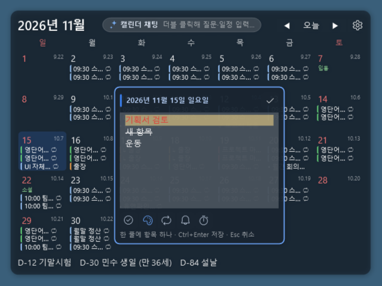
</p>

날짜 칸을 더블클릭하면 위 그림처럼 **할 일 입력 창**이 열립니다. 여러 줄을 자유롭게 고쳐도 기존 항목의 완료 상태·색상·알림·변경 이력이 그대로 보존됩니다.

---

## 3. 화면 구성과 5가지 표시 모드

달력 한 칸에는 양력 날짜, 음력 날짜(`10.7`), 공휴일·대체공휴일(빨간 글씨), 24절기(초록 글씨), 기념일(주황 글씨), 시간·종일 일정(색 막대), 할 일 목록과 아이콘(`↻` 반복 · `⏰` 알림 · `⚑` D-day)이 깔끔하게 정리되어 표시됩니다. 칸 위에 마우스를 올리면 잘린 긴 내용과 절기 시각까지 툴팁으로 볼 수 있습니다.

<p align="center">
  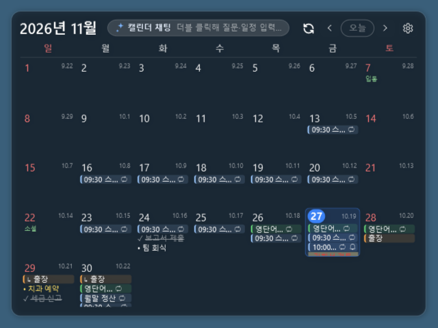
</p>

달력 오른쪽 위 **⚙ → `표시 모드`** 에서 바탕화면 공간에 맞춰 **5가지 모양**으로 즉시 전환할 수 있습니다.

| 표시 모드 | 특징 | 화면 미리보기 |
|---|---|---|
| **고정 월** *(기본)* | 선택한 달(1일~말일)을 고정해서 보여주며, 이번 달이 아닌 앞뒤 빈 칸은 비워 둡니다. | 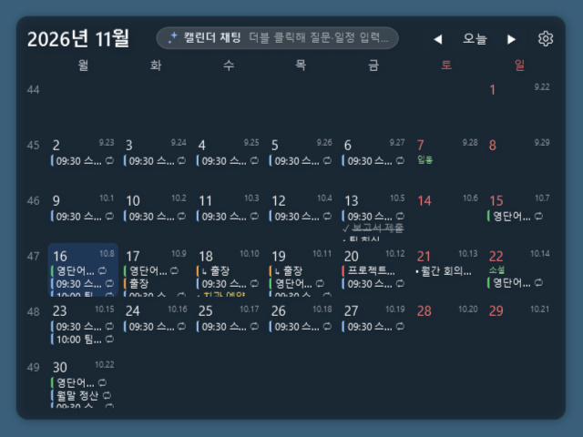 |
| **떠다니는 월** | 오늘이 있는 주가 항상 위쪽에 오도록 주 단위로 흐르며, 다음 달 초까지 한눈에 이어서 볼 수 있습니다. |  |
| **전체 월** | 5주 칸을 꽉 채워 전달 말일과 다음 달 초까지 빈 칸 없이 함께 표시합니다. |  |
| **한 줄** | 이번 달 전체(28~31일)를 가로 한 줄 막대로 압축해 바탕화면 상단·하단에 좁게 두고 봅니다. | 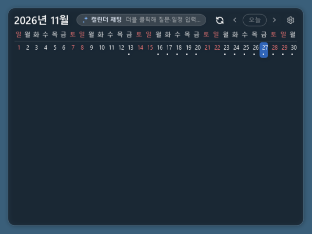 |
| **한 줄 (떠다니는)** | 오늘부터 지정한 일수(기본 14일, 7~31일 설정 가능)만 가로 한 줄로 보여줍니다. | 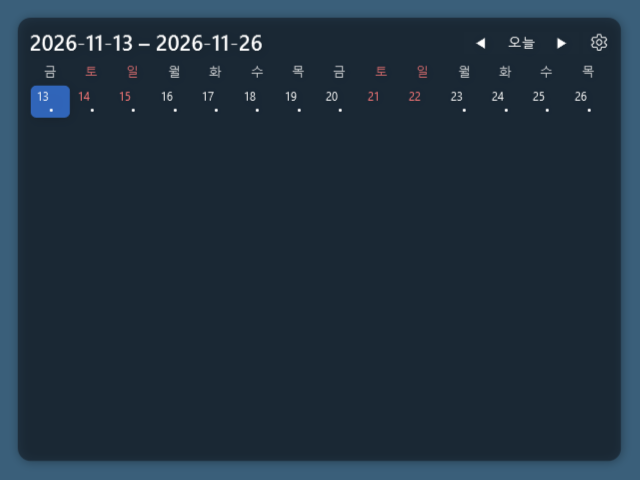 |

---

## 4. 할 일·일정 관리와 스마트 도구

### 4.1 할 일 옵션 바 (완료 · 색상 · 반복 · 알림 · D-day)

날짜 칸을 더블클릭해 할 일을 입력할 때, 커서가 놓인 줄에 위쪽 **5개 옵션 버튼**을 바로 적용할 수 있습니다.

| 버튼 | 기능 | 상세 설정 화면 |
|---|---|---|
| **`✓`** | 현재 줄의 할 일을 완료(취소선) 또는 미완료로 전환합니다. | — |
| **`🎨`** | **글자색**과 **칸 배경색**을 각각 지정합니다(프리셋 팔레트, 직접 색상 선택, 최근 사용 색상 7개 자동 기억). |  |
| **`↻`** | 해당 할 일을 매일·매주·매월·매년·평일·월말·분기말·법정 근무일·음력 매년·에빙하우스 간격으로 **자동 반복** 생성합니다. | 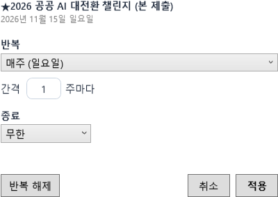 |
| **`⏰`** | 해당 할 일에 대해 당일·1~5일 전·1주일 전 원하는 시각에 **알림**을 최대 5개까지 설정합니다. | 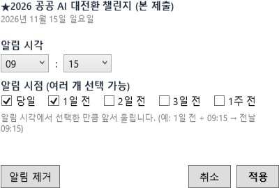 |
| **`⚑`** | 해당 할 일을 **디데이(D-day)** 로 등록해 달력 하단 줄과 바탕화면 디데이 카드에 함께 띄웁니다. | 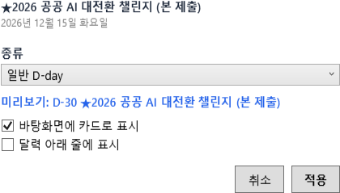 |

---

### 4.2 시간·반복·알림이 있는 일정 만들기

**⚙ → `새 일정 (오늘)`**, 날짜 칸 **우클릭 → `일정 추가…`**, 또는 **`Ctrl+Alt+E`** 를 누르면 카드형으로 정돈된 **새 일정 / 일정 수정** 창이 열립니다.

<p align="center">
  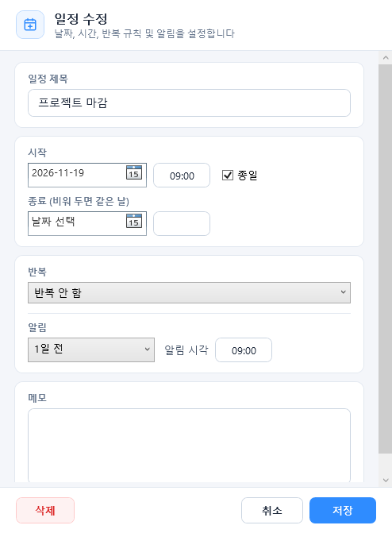
  &nbsp;&nbsp;
  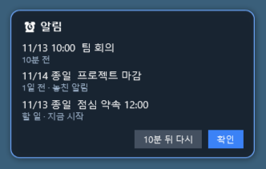
</p>

- **시간 및 다일 일정**: 시작·종료 시각(`09:00`~`18:00`) 또는 `종일` 체크를 지원하며, 종료 날짜를 뒤로 지정하면 여러 날에 걸친 일정(`↳`)으로 표시됩니다.
- **풍부한 반복 규칙**: 매일·매주(요일 복수 선택)·매월(같은 날짜 또는 `N번째 요일`/`마지막 요일`)·매년·평일·월말·분기말·대한민국 법정 근무일(주말·공휴일 자동 제외)·음력 매년·에빙하우스 복습 주기(당일+1·2·4·7·15·30일)와 반복 종료(무한·N회 후·종료일)를 지원합니다.
- **반복 일정 부분 수정·삭제**: 반복 일정을 고치거나 지울 때 **`이 일정만` / `이 일정과 이후 모든 일정` / `모든 일정`** 중 범위를 선택할 수 있습니다.
- **알림 카드**: 예정 시각이 되면 작업 중인 창을 방해하지 않고 화면 오른쪽 아래에 알림 카드가 뜨며, **`확인`** 또는 **`10분 뒤 다시`**(스누즈)를 누를 수 있습니다. PC가 꺼져 있는 동안 지난 알림(24시간 이내)은 프로그램을 켤 때 `(놓친 알림)`으로 알려 줍니다.

---

### 4.3 빠른 입력 — 한 문장으로 일정 추가·질문

**⚙ → `빠른 입력`** 을 열면 시작·종료 칸을 일일이 고르는 대신 평소 말하듯 한 줄로 적어 일정을 등록하거나 달력에 질문할 수 있습니다.

<p align="center">
  
</p>

- **일정·할 일 즉시 해석**: `다음 주 화요일 오후 2시 A사 미팅 1시간, 15분 전 알림`, `매주 월수금 아침 7시 운동`, `12월 3일 종일 치과 하루 전 알림`처럼 입력하면 날짜·시각·반복·알림을 실시간으로 분석해 아래 미리보기 카드에 보여줍니다.
- **달력 질문 응답**: `이번 주 일정 보여줘`, `다음 회의 언제야?`, `밀린 할 일 몇 개야?`처럼 물으면 달력 데이터를 찾아 바로 답해 줍니다.
- **규칙 우선 + AI 보조**: 한국어 날짜·시간 규칙으로 먼저 0초 만에 해석하고, 규칙만으로 읽기 어려운 복잡한 문장은 로컬 AI(Ollama 연결 시)로 넘겨 처리합니다. 잘못 추가한 경우 **`마지막 추가 되돌리기`** 버튼으로 즉시 취소할 수 있습니다.

---

### 4.4 텍스트·이미지(OCR)에서 일정 추출

**⚙ → `텍스트에서 일정 추출`** 을 열면 긴 공지사항·이메일·메신저 대화나 안내문 캡처 이미지에서 날짜가 들어 있는 일정과 할 일을 한꺼번에 뽑아냅니다.

<p align="center">
  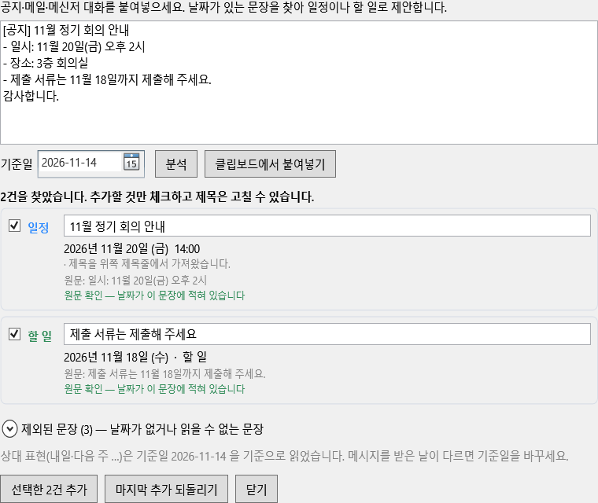
</p>

- **클립보드·이미지 드래그 지원**: 텍스트를 붙여넣거나, 화면을 캡처한 뒤 **`클립보드 (글·이미지)`** 버튼을 누르거나(`Ctrl+V`), 이미지 파일(`.png`, `.jpg` 등)을 창으로 끌어다 놓으면 Windows 내장 한국어 OCR이 글자를 읽어 일정을 찾아냅니다.
- **안전한 검토 후 추가**: 찾아낸 후보마다 원문 근거 문장을 함께 보여주며, 추가할 항목만 체크하고 제목을 다듬은 뒤 **`선택한 N건 추가`** 를 누르면 달력에 한 번에 등록됩니다.

---

### 4.5 복습 계획 만들기 (에빙하우스 간격 반복)

**⚙ → `복습 계획 만들기`** 는 공부한 내용이나 시험 과목을 입력하면 잊어버리기 전에 다시 볼 날짜들을 할 일로 자동 배치해 주는 도구입니다.

<p align="center">
  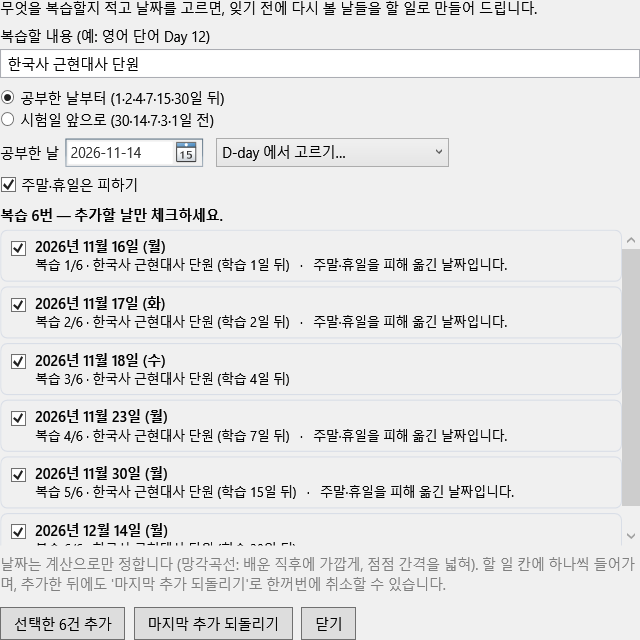
</p>

- **두 가지 계획 방식**:
  1. **공부한 날부터 (`1 · 2 · 4 · 7 · 15 · 30일 뒤`)**: 오늘 배운 단원을 장기 기억으로 옮기는 6회 복습 일정을 생성합니다.
  2. **시험일 앞으로 (`30 · 14 · 7 · 3 · 1일 전`)**: 등록해 둔 시험 D-day를 고르거나 시험 날짜를 지정해 역산 마무리 복습 일정을 잡습니다.
- **주말·공휴일 피하기**: `주말·휴일은 피하기`를 켜 두면 복습일이 일요일이나 공휴일에 걸릴 때 가장 가까운 평일로 자동 조정해 줍니다.

---

### 4.6 미완료 정리 — 밀린 할 일 한 번에 옮기기

**⚙ → `미완료 정리`** 는 지난 30일 동안 체크하지 못하고 지나간 미완료 할 일들을 모아서 보여주고 원하는 날로 깔끔하게 옮겨 줍니다.

<p align="center">
  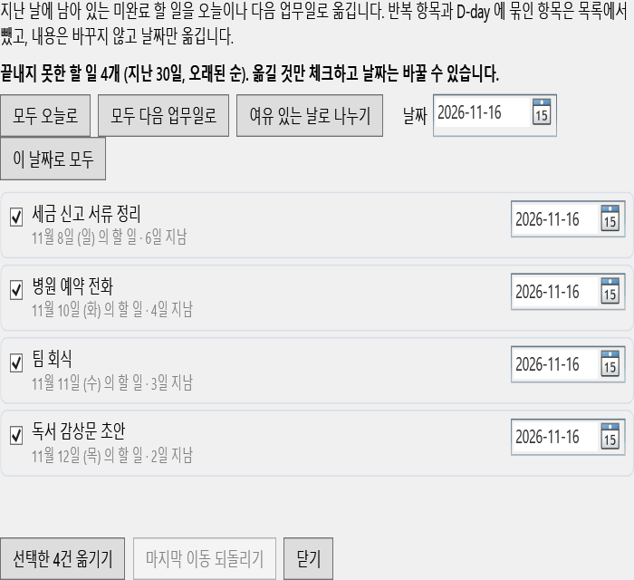
</p>

- **일괄 배치 버튼**: **`모두 오늘로`**, **`모두 다음 업무일로`**(주말·공휴일 제외), **`여유 있는 날로 나누기`**(앞으로 5업무일 중 일정·할 일이 가장 적은 날들로 자동 분산), 또는 원하는 날짜를 지정해 한 번에 옮길 수 있습니다.
- 이미 여러 번 미룬 항목은 `N번 미룸 — 작게 나누거나 지우는 건 어떨까요?` 안내가 함께 표시되어 할 일 목록이 끝없이 쌓이는 것을 막아 줍니다.

---

### 4.7 오늘 브리핑 & 지난 7일 돌아보기

**⚙ → `오늘 브리핑`** 은 오늘 하루의 일정·할 일·디데이 요약과 지난 일주일의 달성 통계를 한눈에 보여주는 대시보드입니다.

<p align="center">
  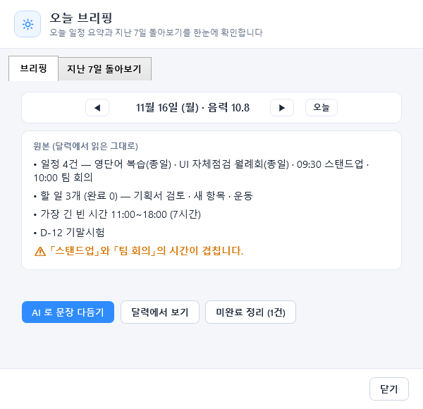
</p>

- **브리핑 탭**: 선택한 날짜(기본 오늘)의 양력·음력·공휴일·절기, 시간순 일정, 할 일(완료/미완료), 다가오는 D-day를 카드 하나로 요약합니다. 로컬 AI(Ollama)가 켜져 있으면 **`AI 로 문장 다듬기`** 로 자연스러운 아침 브리핑 문장으로 읽어 볼 수도 있습니다.
- **지난 7일 돌아보기 탭**: 지난 일주일간의 할 일 완료율(`완료 N / 전체 M`), 일정 건수, 가장 바빴던 요일, 아직 남아 있는 미완료 할 일 목록을 집계해 보여줍니다.

---

## 5. 메뉴 및 캘린더 설정 창

### 5.1 달력 오른쪽 위 ⚙ 빠른 메뉴

달력 제목줄 오른쪽의 **⚙ 아이콘**을 클릭하면 기능 성격에 따라 **3개 그룹(`일정 · 도구`, `화면 표시`, `설정`)** 으로 정리된 빠른 메뉴가 열립니다.

<p align="center">
  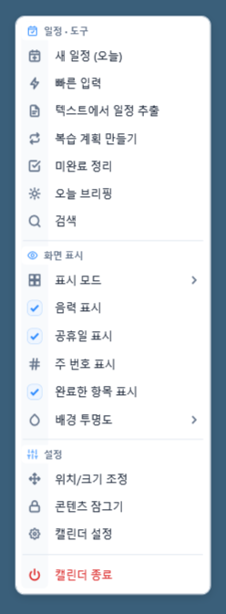
</p>

| 그룹 | 메뉴 항목 | 동작 설명 |
|---|---|---|
| **📅 일정 · 도구** | **새 일정 (오늘)** | 오늘 날짜로 [일정 편집기](#42-시간반복알림이-있는-일정-만들기)를 엽니다 (`Ctrl+Alt+E`). |
| | **빠른 입력** | 한 문장으로 일정을 추가하거나 질문하는 [빠른 입력 창](#43-빠른-입력--한-문장으로-일정-추가질문)을 엽니다. |
| | **텍스트에서 일정 추출** | 공지·메일·캡처 이미지(OCR)에서 일정을 뽑아내는 [추출 창](#44-텍스트이미지ocr에서-일정-추출)을 엽니다. |
| | **복습 계획 만들기** | 공부한 날 또는 시험일 기준으로 [복습 할 일](#45-복습-계획-만들기-에빙하우스-간격-반복)을 배치합니다. |
| | **미완료 정리** | 지난 날의 끝내지 못한 할 일을 모아 [원하는 날짜로 옮깁니다](#46-미완료-정리--밀린-할-일-한-번에-옮기기). |
| | **오늘 브리핑** | 오늘 요약과 지난 7일 통계를 보여주는 [브리핑 창](#47-오늘-브리핑--지난-7일-돌아보기)을 엽니다. |
| | **검색** | 할 일과 일정을 키워드·필터·의미로 찾는 [검색 창](#7-부가-기능-검색--디데이--메모--시간표--배경-사진--내보내기--인쇄)을 엽니다 (`Ctrl+Alt+F`). |
| **👁 화면 표시** | **표시 모드 ▸** | 고정 월 / 떠다니는 월 / 전체 월 / 한 줄 / 한 줄(떠다니는) 중 선택합니다. |
| | **음력 표시 · 공휴일 표시 · 주 번호 표시 · 완료한 항목 표시** | 각 항목을 달력 칸에 표시할지 즉시 켜고 끕니다. |
| | **배경 투명도 ▸** | 달력 배경 불투명도를 20% ~ 95% 사이에서 바로 조절합니다. |
| **🎚 설정** | **위치/크기 조정** | 달력과 위젯을 마우스로 드래그해 옮기거나 크기를 조절하는 편집 모드를 켭니다. |
| | **콘텐츠 잠그기** | 달력에 적힌 개인 내용을 즉시 숨깁니다 (`Ctrl+Alt+L`). |
| | **캘린더 설정** | 모든 세부 설정을 다루는 8개 탭 설정 창을 엽니다. |
| *(하단)* | **캘린더 종료** | 프로그램을 완전히 종료합니다. |

---

### 5.2 달력 위치·크기 조정

평소에는 바탕화면 아이콘 클릭을 방해하지 않도록 달력 테두리 드래그가 잠겨 있습니다. **⚙ → `위치/크기 조정`** 을 누르면 달력 둘레에 **노란 점선 테두리**가 나타나며 자유롭게 옮기고 크기를 바꿀 수 있습니다.

<p align="center">
  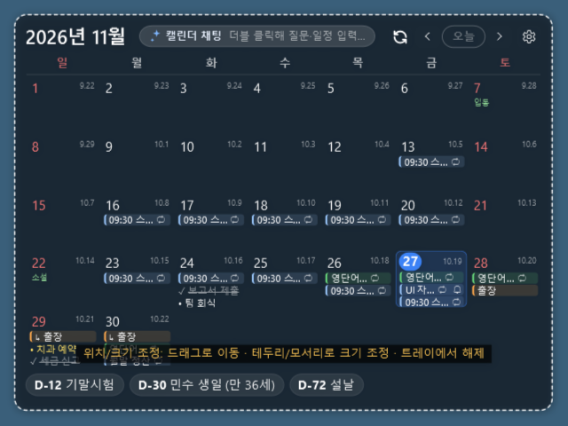
</p>

1. 달력 안쪽 아무 곳이나 마우스로 잡고 끌어 원하는 위치에 놓습니다(디데이 카드와 시간표 위젯도 이 모드에서 함께 드래그해 배치할 수 있습니다).
2. 달력 네 변이나 모서리를 잡고 끌어 원하는 크기로 조절합니다.
3. 오른쪽 위 파란 **`완료`** 버튼을 누르거나 **`Esc`** 키를 누르면 그 자리에 다시 고정됩니다.

---

### 5.3 작업 표시줄 트레이 메뉴

시계 옆 작업 표시줄(시스템 트레이)에는 **오늘 날짜 숫자**가 적힌 작은 달력 아이콘이 상주합니다.
- **트레이 아이콘 더블클릭**: 달력 숨기기 / 보이기 전환
- **트레이 아이콘 우클릭**: 메모·디데이·시간표 관리, 가져오기/내보내기, 인쇄, CalDAV·MCP 연결, 휴일 데이터 편집 등 전체 관리 메뉴 열기

<p align="center">
  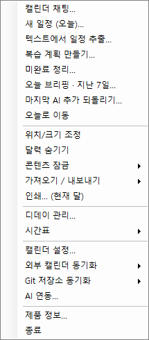
</p>

---

### 5.4 캘린더 설정 창 (8개 탭 상세 안내)

**⚙ → `캘린더 설정`** 을 열면 왼쪽에 8개 탭이 있는 설정 창이 열립니다. 모든 설정은 바꾸는 즉시 달력에 반영되고 자동 저장됩니다. 원래 상태로 되돌리고 싶을 때는 왼쪽 아래 **`기본 설정으로 사용`** 을 누르세요.

#### ① 캘린더 탭 — 표시 모드 · 배경 스타일 · 음력/절기/공휴일 · 자동 실행
표시 모드, 배경 단색/사진 폴더 스킨, 그림자 효과, 제목줄 숨기기, 음력·24절기·공휴일·기념일 표시 여부, Windows 시작 시 자동 실행을 설정합니다.

<p align="center">
  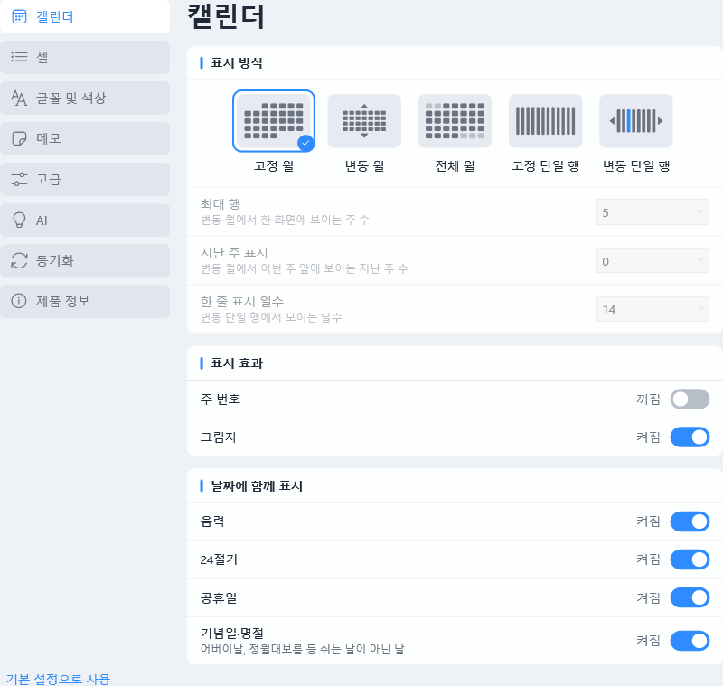
</p>

#### ② 셀 탭 — 주 시작 요일 · 줄 수 · 쉬는 요일 · 할 일 머리 기호
한 주의 시작 요일(일/월/토), 달력 최대 행 수(4~6줄), 칸 사이 간격, 쉬는 요일(일·토 등 빨간색 표시), 완료한 항목 맨 아래로 내리기, 할 일 앞 기호(`•` 점 / `1.` 번호 / 없음), 완료 효과음을 설정합니다.

<p align="center">
  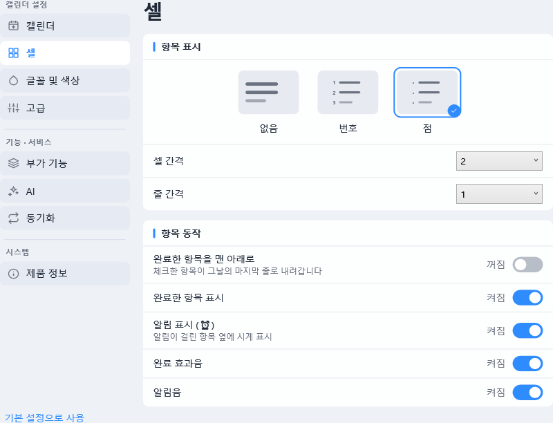
</p>

#### ③ 글꼴 및 색상 탭 — 글꼴 · 크기 · 글자색 · 칸 배경색 · 투명도
달력 글꼴, 본문 글자 크기(9~22pt), 일반 글자색, 공휴일·쉬는 날 글자색, 평일·주말·오늘 칸 배경색과 칸 투명도를 세밀하게 꾸밉니다.

<p align="center">
  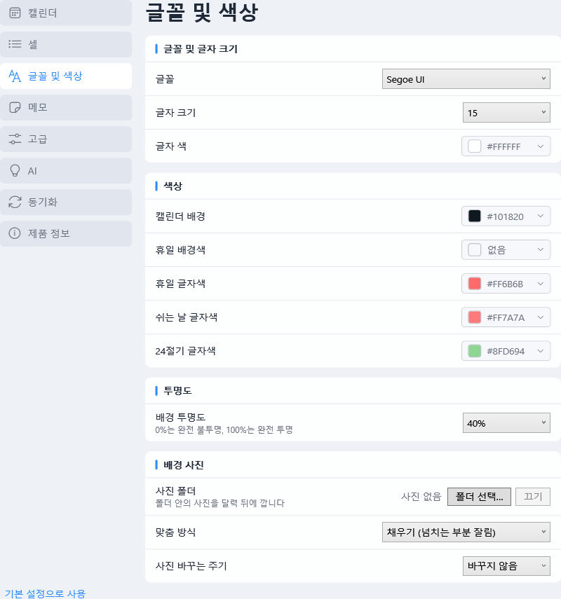
</p>

#### ④ 메모 탭 — 메모장 · 디데이 · 시간표 바로가기
메모장 열기, 디데이(카운트다운) 관리 창 열기, 주간 시간표 편집기 열기 및 바탕화면 시간표 위젯 표시 여부를 전환합니다.

<p align="center">
  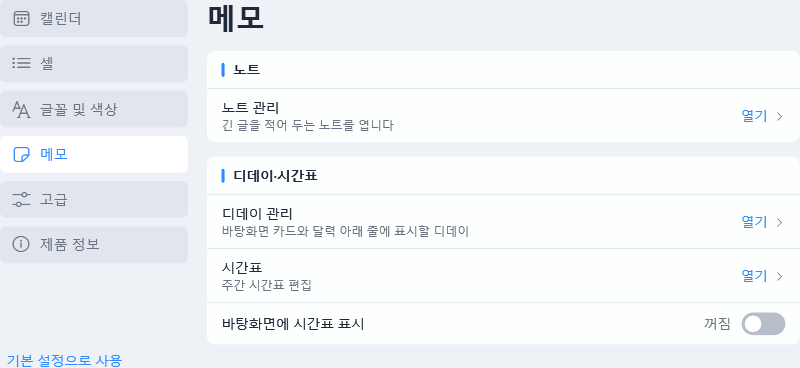
</p>

#### ⑤ 고급 탭 — 전역 단축키 · 콘텐츠 잠금 비밀번호 · 데이터 백업/가져오기/인쇄
어느 화면에서든 바로 누르는 전역 단축키 5종 변경, 콘텐츠 잠금 및 비밀번호 설정/해제, JSON·CSV·ICS·Excel 내보내기와 가져오기, 현재 달 A4 인쇄, `holidays.json` 수동 휴일 편집을 제공합니다.

<p align="center">
  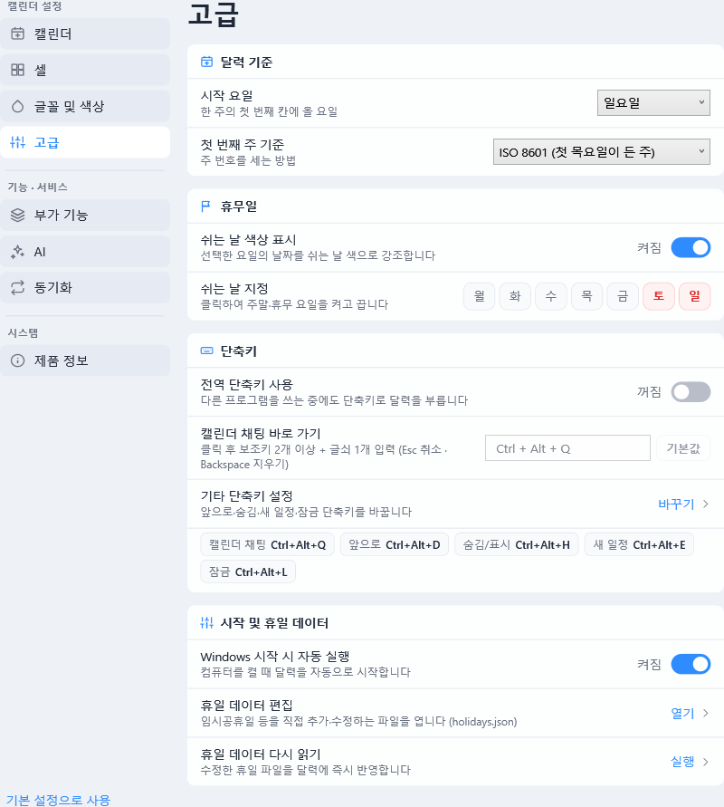
</p>

#### ⑥ AI 탭 — 로컬 AI(Ollama) 연결 · 의미 검색 색인 · 외부 AI(MCP) 승인
내 컴퓨터에 설치된 로컬 AI([Ollama](https://ollama.com)) 연결 상태를 점검하고 채팅·임베딩 모델을 선택합니다(AI를 켜지 않아도 모든 기본 규칙 도구는 정상 작동합니다).

<p align="center">
  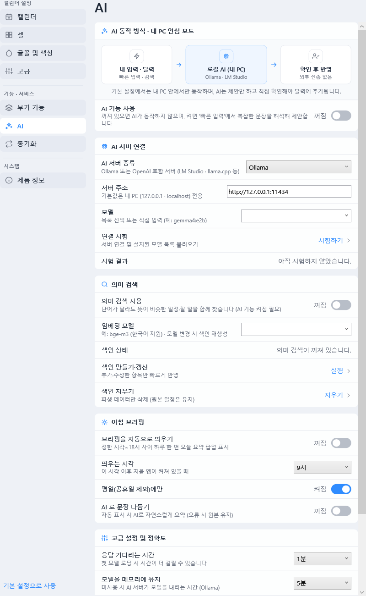
</p>

#### ⑦ 동기화 탭 — 내 Git 저장소를 통한 여러 컴퓨터 간 동기화
별도 계정 가입이나 유료 클라우드 없이 **내 비공개 Git 저장소(GitHub 등)** 하나만으로 집·사무실 등 여러 대의 컴퓨터에서 달력 전체(할 일·일정·디데이·메모·시간표·휴일 보정)를 자동으로 합치고 동기화합니다. 탭 상단에 처음 설정하는 방법부터 단계별 안내가 적혀 있습니다.

<p align="center">
  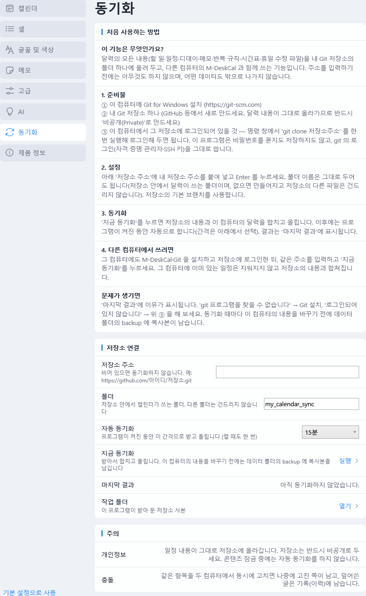
</p>

#### ⑧ 제품 정보 탭 — 버전 · 데이터 폴더 · 진단 정보
현재 프로그램 버전, 일정과 설정이 저장된 `%AppData%\DeskCal` 폴더 열기, 문제 해결용 진단 정보를 확인합니다.

<p align="center">
  
</p>

---

## 6. 단축키 모음

### 전역 단축키 (다른 프로그램을 쓰는 중에도 언제든 동작)

> **캘린더 설정 → `고급` 탭 → `단축키 변경`** 에서 원하는 키 조합으로 바꿀 수 있습니다.

| 기본 단축키 | 동작 |
|---|---|
| **`Ctrl + Alt + D`** | 바탕화면에 있는 달력을 **잠시 맨 앞으로** 불러옵니다(다른 곳을 클릭하면 다시 바탕화면으로 내려갑니다). |
| **`Ctrl + Alt + H`** | 달력을 **숨기거나 다시 표시**합니다(디데이 카드·시간표 위젯도 함께 숨겨집니다). |
| **`Ctrl + Alt + E`** | **오늘 날짜로 새 일정 편집기**를 바로 엽니다. |
| **`Ctrl + Alt + F`** | 할 일·일정 **검색 창**을 바로 엽니다. |
| **`Ctrl + Alt + L`** | 달력 내용을 가리는 **콘텐츠 잠금**을 켜거나 끕니다. |

### 편집기 내부 단축키

| 단축키 | 동작 |
|---|---|
| **`Ctrl + Enter`** | 날짜 칸 할 일 편집기에서 입력한 내용을 저장하고 닫습니다. |
| **`Esc`** | 할 일 편집 취소 / 열려 있는 대화상자 닫기 / 위치·크기 조정 모드 완료 |
| **`Ctrl + S`** | 메모장 창에서 현재 메모 즉시 저장 |
| **`Ctrl + V`** | 일정 추출 창에서 클립보드의 텍스트 또는 캡처 이미지를 바로 붙여넣어 분석 |

---

## 7. 부가 기능 (검색 · 디데이 · 메모 · 시간표 · 배경 사진 · 내보내기 · 인쇄)

### 🔍 통합 검색 및 변경 이력 복원 (`⚙ → 검색` 또는 `Ctrl+Alt+F`)
- 검색어를 입력하면 할 일과 일정을 즉시 찾아 주며, **기간 · 종류(할 일/일정) · 완료 여부 · 글자색 · 삭제된 할 일 포함** 필터를 조합할 수 있습니다.
- 로컬 AI 임베딩이 연결된 경우 **`의미로도 찾기`** 를 체크해 단어가 정확히 일치하지 않아도 뜻이 비슷한 항목(예: `병원`으로 `치과 검진`, `내과 진료` 검색)을 함께 찾습니다.
- 결과를 더블클릭하면 달력에서 해당 날짜로 이동하며, **`이력 보기`** 로 예전에 수정하기 전 내용을 시대순으로 확인·복원하거나 **`삭제된 항목 복원`** 으로 지운 할 일을 되살릴 수 있습니다.

<p align="center">
  
</p>

### ⏳ 디데이 / 카운트다운 카드 (`캘린더 설정 → 메모 탭 → 디데이 관리`)
- **일반/시험**(`D-12`, `D-Day`, `D+3`), **만난 날/기념일**(`100일째 · 1주년 D-265`), **생일**(매년 돌아오며 `만 N세` 자동 표시), **명절**(음력 날짜 지원) 4가지 유형을 지원합니다.
- 달력 하단 한 줄 요약과 **바탕화면 디데이 카드 위젯**으로 동시에 띄워 둘 수 있습니다.

<p align="center">
  
</p>

### 📝 메모장 & 🕒 주간 시간표 위젯 (`캘린더 설정 → 메모 탭`)
- **메모장**: 날짜와 상관없이 기억해 둘 내용을 적는 노트입니다. 메모마다 7가지 배경색을 지정할 수 있고, 자동 저장되며 본문 수정 이력 복원과 삭제한 메모 되살리기를 지원합니다.
- **주간 시간표**: 하루 교시 수(1~12교시), 첫 수업 시각, 수업/쉬는 시간, 점심시간을 넣으면 교시 시각표가 자동 계산됩니다. **바탕화면 시간표 위젯**을 켜 두면 오늘 요일 열과 **지금 진행 중인 교시(또는 다음 교시)** 를 노란색으로 강조해 보여줍니다.

<p align="center">
  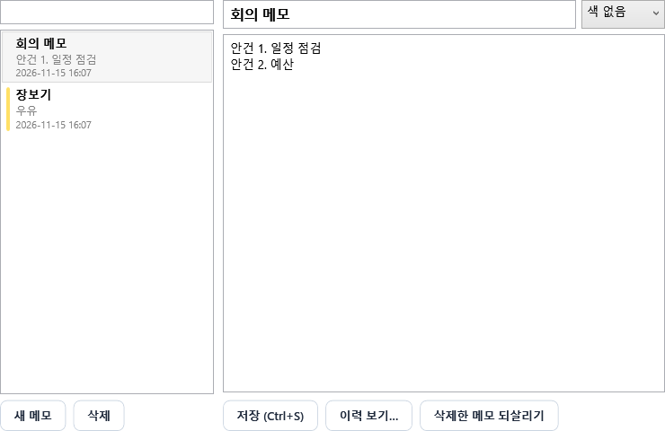
  &nbsp;&nbsp;
  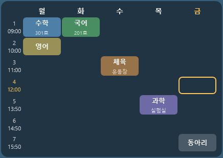
</p>
<p align="center">
  
</p>

### 🖼 배경 사진 스킨 & 나만의 색상 꾸미기
- **캘린더 설정 → `캘린더` 탭 → `배경 스타일: 사진 폴더`** 를 고르고 사진이 들어 있는 폴더를 지정하면, 달력 배경에 사진을 깔고 5분~하루 간격으로 자동 순환시킬 수 있습니다.

<p align="center">
  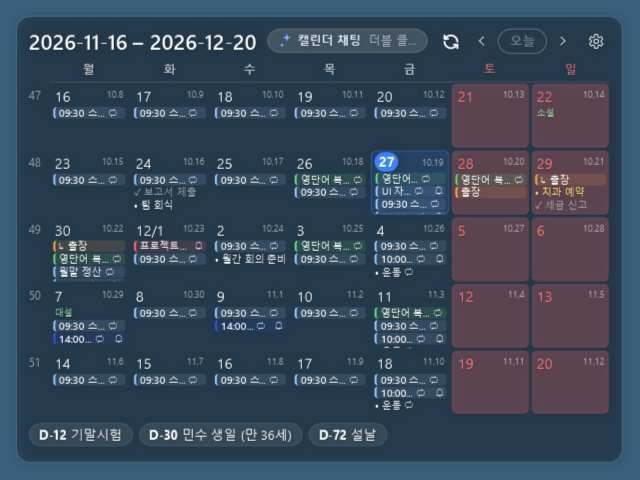
</p>

### 📦 백업 · 가져오기 / 내보내기 (JSON · CSV · ICS · Excel) & 🖨 인쇄
- **내보내기**: 전체 데이터 백업용 **`.json`**, 엑셀 편집용 **`.csv`**(UTF-8 BOM), Google·Apple·Outlook 달력과 호환되는 표준 **`.ics`**, 그리고 전체 목록 시트와 월별 달력 시트를 함께 만들어 주는 **Excel(`.xlsx`)** 4가지 형식을 지원합니다.
- **가져오기**: `.json`, `.csv`, `.ics` 파일을 가져오기 전에 건수와 경고를 먼저 확인하고, 기존 DB를 `backup/before-import-날짜.db`로 자동 백업한 뒤 중복 없이 안전하게 합칩니다.
- **현재 달 인쇄**: 가로 방향 A4 한 장에 맞춘 깔끔한 흰 바탕 달력으로 바로 인쇄하거나 PDF로 저장할 수 있습니다.

<p align="center">
  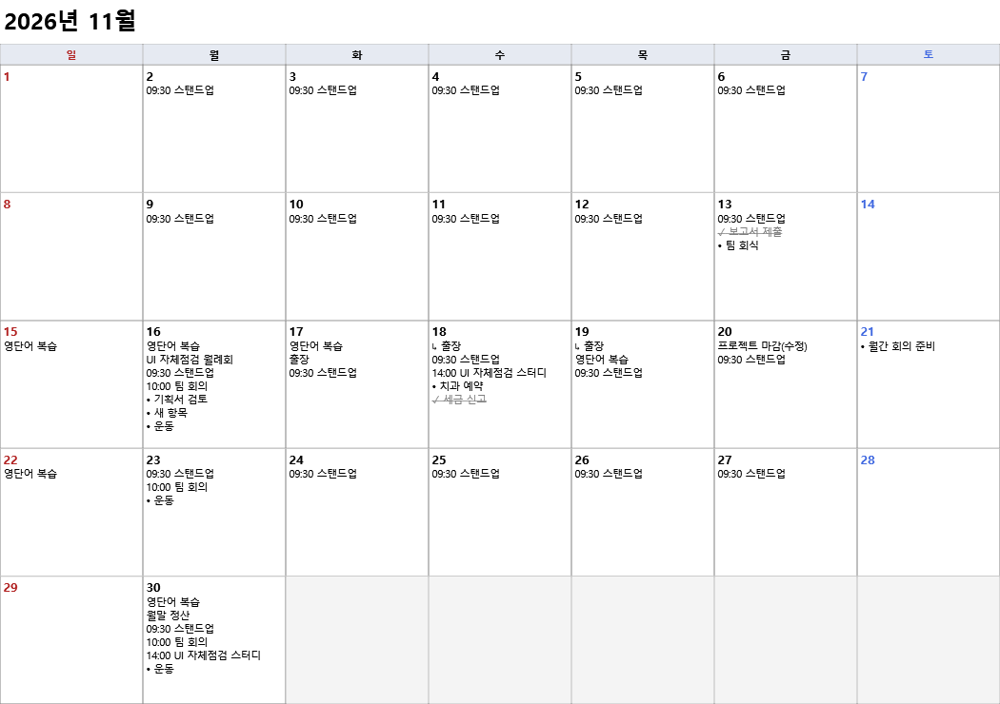
</p>

---

## 8. 콘텐츠 잠금 (사생활 보호)

자리를 비우거나 화면을 공유할 때 **`Ctrl+Alt+L`** 또는 **⚙ → `콘텐츠 잠그기`** 를 누르면 달력에 적힌 모든 개인 내용(할 일·일정·디데이 줄)이 즉시 숨겨지고 날짜와 공휴일만 남습니다. 디데이 카드와 시간표 위젯도 함께 숨겨지며, 알림이 울려도 제목 대신 `🔒 잠긴 알림`으로만 표시됩니다.

- **비밀번호 설정**: **캘린더 설정 → `고급` 탭 → `비밀번호 설정 / 변경`** 에서 비밀번호(4자 이상)를 걸어 두면, 잠금을 풀거나 편집·검색·내보내기를 할 때 비밀번호를 물어봅니다.

<p align="center">
  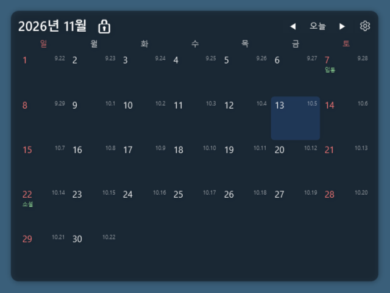
</p>

---

## 9. 동기화(Git · CalDAV) 및 외부 AI 연동(MCP)

이 기능들은 사용자가 직접 주소를 입력하거나 스위치를 켜기 전에는 전혀 동작하지 않으며, 어떤 데이터도 외부로 보내지 않습니다.

### 9.1 내 Git 저장소로 여러 컴퓨터 동기화 (`캘린더 설정 → 동기화 탭`)
1. 컴퓨터에 [Git for Windows](https://git-scm.com)를 설치하고, GitHub 등에서 **비공개(Private) 저장소**를 하나 만듭니다.
2. **캘린더 설정 → `동기화` 탭**의 `저장소 주소` 칸에 내 저장소 주소(예: `https://github.com/아이디/저장소.git`)를 붙여 넣고 `Enter`를 누른 뒤 **`지금 동기화 → 실행`** 을 누릅니다.
3. 다른 컴퓨터에서도 똑같이 주소를 입력하면 두 컴퓨터의 할 일·일정·디데이·메모·시간표가 지워지지 않고 항목 단위로 안전하게 합쳐집니다(변경 전에는 항상 `backup/` 폴더에 자동 백업본이 남습니다).

### 9.2 외부 캘린더(CalDAV) 양방향 동기화 (`트레이 우클릭 → 동기화 및 AI 연결 → 외부 캘린더 동기화`)
- Google 캘린더, iCloud, Fastmail, Nextcloud 등 CalDAV 서버의 **일정(이벤트)** 을 양방향으로 동기화합니다. 비밀번호는 Windows 자격 증명 관리자(DPAPI)로 암호화해 현재 Windows 계정에만 저장됩니다.

<p align="center">
  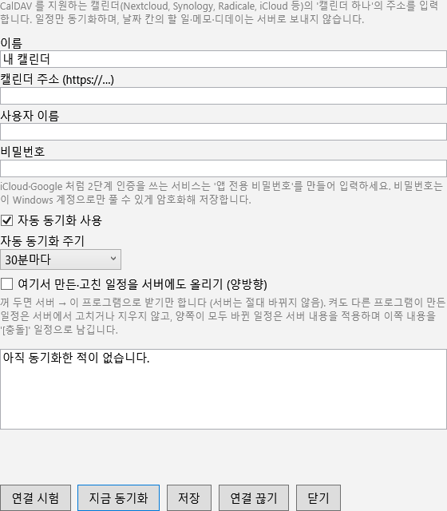
</p>

### 9.3 외부 AI 에이전트(MCP) 연결 (`트레이 우클릭 → 동기화 및 AI 연결 → AI (MCP) 연결`)
- Claude Desktop 등 MCP(Model Context Protocol)를 지원하는 AI 앱이 내 달력을 읽고 일정을 제안할 수 있게 해 주는 로컬 파이프(`DeskCal.Mcp.exe`) 서버입니다.
- **읽기는 자유롭게, 쓰기는 내 승인을 거친 뒤에만**: AI가 일정을 추가·수정·삭제하려고 하면 달력에 바로 반영되지 않고 아래 **승인 대기 목록**에 먼저 쌓입니다. 내가 직접 내용을 확인하고 **`승인`** 을 눌러야만 달력에 반영됩니다.

<p align="center">
  
</p>

---

## 10. 문제 해결 (FAQ)

- **달력을 실행했는데 화면에 보이지 않아요.**
  - **`Ctrl + Alt + D`** (앞으로 불러오기) 또는 **`Ctrl + Alt + H`** (숨기기/보이기 전환)를 눌러 보세요.
  - 모니터 해상도나 배율을 바꾼 뒤 화면 밖으로 벗어났다면, 트레이 아이콘 우클릭 → **`캘린더 설정` → 왼쪽 아래 `기본 설정으로 사용`** 을 누른 뒤 프로그램을 다시 켜면 기본 위치로 돌아옵니다.
- **내 일정 데이터 파일은 어디에 저장되나요? 다른 PC로 통째로 옮기려면?**
  - 트레이 아이콘 우클릭 → **`데이터 폴더 열기`** 를 누르면 `%AppData%\DeskCal` 폴더가 열립니다.
  - 이 폴더 안의 **`deskcal.db`** 파일 하나에 모든 일정·할 일·디데이·메모·시간표·설정이 들어 있으며, `backup\` 폴더에 최근 자동 백업본 10개가 보관됩니다. 다른 컴퓨터의 `%AppData%\DeskCal` 폴더에 `deskcal.db`를 그대로 복사해 넣거나 **JSON 내보내기/가져오기**를 쓰면 그대로 이어서 쓸 수 있습니다.
- **단축키 등록에 실패했다고 나와요.**
  - 다른 프로그램이 같은 단축키를 이미 사용 중일 때 알림이 뜹니다. **캘린더 설정 → `고급` 탭 → `단축키 변경`** 에서 다른 키 조합으로 바꾸어 주세요.

---

## 11. 문서 모음 및 개발자 안내

- **상세 문서**
  - [전체 사용자 가이드 (`docs/USER_GUIDE.md`)](docs/USER_GUIDE.md)
  - [릴리스 노트 (`docs/RELEASE_NOTES.md`)](docs/RELEASE_NOTES.md)
  - [설계 및 구현 기록 (`docs/DESIGN_AND_PLAN.md`)](docs/DESIGN_AND_PLAN.md)
  - [AI 도구 설계 및 검토 (`docs/AI_FEATURE_REVIEW.md`)](docs/AI_FEATURE_REVIEW.md)

- **소스에서 빌드 및 테스트 (.NET 10 SDK · Windows 10/11)**
  ```powershell
  # 개발 실행
  dotnet run --project src/DeskCal.App

  # 단위 테스트 실행 (937개)
  dotnet test

  # 오프스크린 UI 자체 점검 및 문서용 스크린샷 생성
  dotnet run --project src/DeskCal.App -- --db=%TEMP%\snap.db --snapshot=%TEMP%\snap --seed --docshots
  python tools/collect-doc-images.py %TEMP%\snap

  # 배포용 경량 단일 패키지 생성 (release\M-DeskCal-<버전>-win-x64.zip)
  powershell -ExecutionPolicy Bypass -File tools\package.ps1
  ```
- **프로젝트 구조**: `src/DeskCal.Core`(도메인·반복 규칙·한국 음력/절기/공휴일·검색·가져오기/내보내기) · `src/DeskCal.Data`(SQLite WAL 저장소·스키마 마이그레이션 v1~v8) · `src/DeskCal.Sync`(Git 저장소 동기화·CalDAV·MCP 파이프 서버) · `src/DeskCal.Ai`(한국어 규칙 해석·OCR·복습 계획·브리핑·Ollama 클라이언트) · `src/DeskCal.App`(WPF 데스크톱 앱) · `src/DeskCal.Mcp`(표준 입출력 MCP 브리지) · `tests/DeskCal.Tests`(xUnit 단위 테스트 937개).
