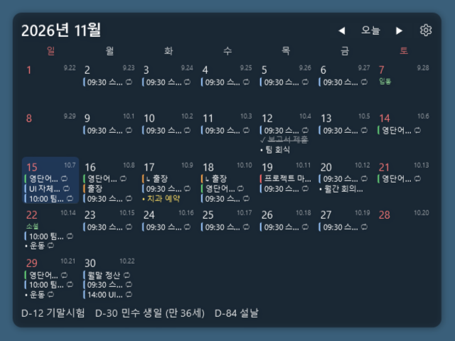
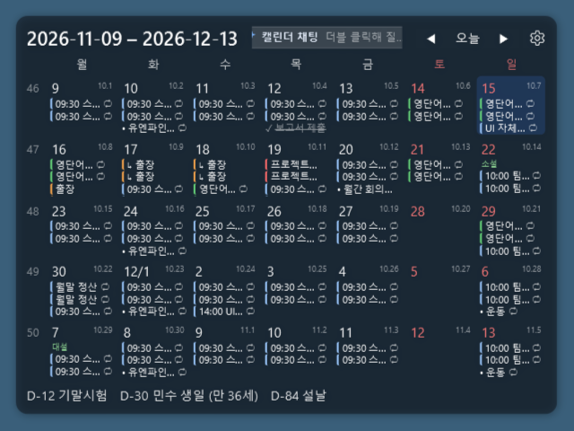
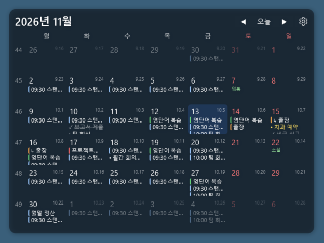
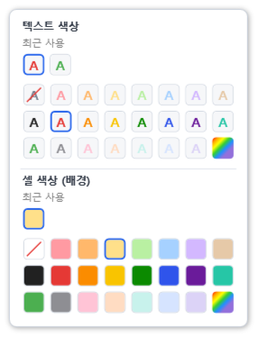
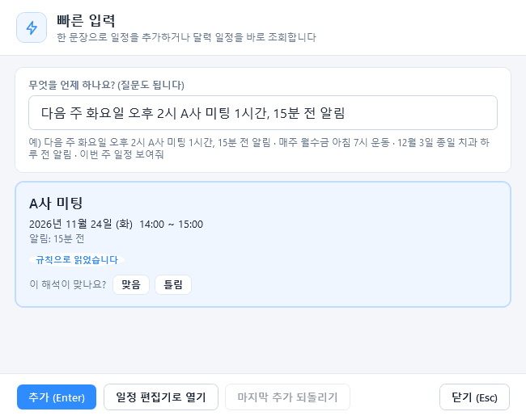
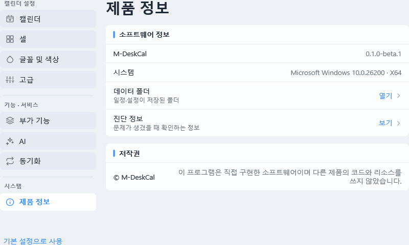
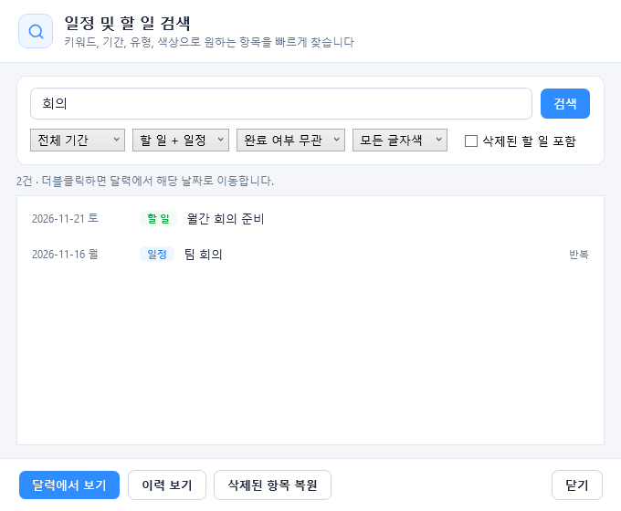
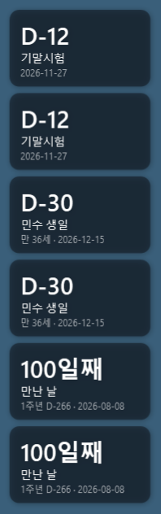
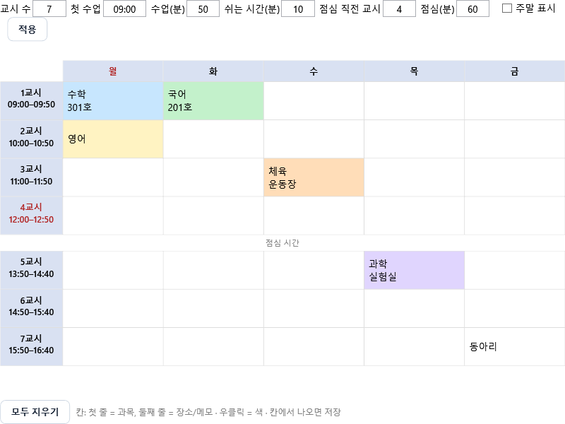
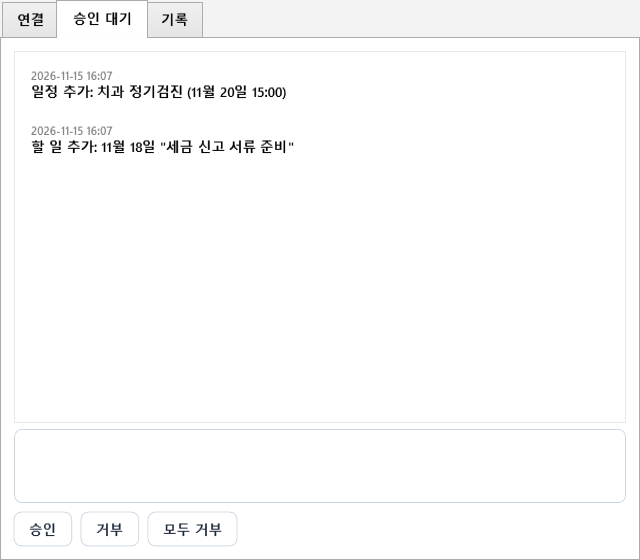

# M-DeskCal — 바탕화면 달력

Windows 바탕화면에 붙어 있는 달력입니다. **날짜 칸에 바로 할 일을 적고**, 반복·알림·D-day를 걸고, 한국 **공휴일·음력·24절기**를 함께 봅니다.
데이터는 내 PC(`%AppData%\DeskCal`)에만 저장되며, 외부 통신은 **내가 켠 동기화·AI 연동**에 한해서만 일어납니다.



> **베타(0.1.0-beta.1)** · Windows 10/11 x64 · .NET 설치 불필요 · 중요한 내용은 가끔 **내보내기(JSON)** 로 백업하세요.

| 이런 일을 합니다 | |
|---|---|
| 📝 날짜 칸에 할 일 적기 | 더블클릭 → 한 줄에 하나씩 입력. 완료·색·반복·알림·D-day |
| 📅 일정 관리 | 시간·종일·여러 날·반복·알림 카드 |
| 🇰🇷 한국 달력 | 공휴일·대체공휴일·음력·24절기·기념일 내장 |
| 🔍 검색·이력 | 글자·기간·색·완료 여부로 찾기, 이전 내용 복원 |
| 🧩 부가 기능 | D-day 카드 · 메모 · 시간표 · 배경 사진 · 인쇄 · 가져오기/내보내기 |
| 🔒 화면 가리기 | 내용을 한 번에 숨기는 콘텐츠 잠금 |
| 🔄 연동(선택) | CalDAV 캘린더 동기화, AI(MCP) 연동 |

**목차** — [설치](#1-설치) · [시작하기](#2-5분-시작하기) · [표시 모드](#3-화면과-표시-모드) · [할 일·일정](#4-할-일과-일정) · [**설정 메뉴 사용법**](#5-설정-메뉴-사용법) · [단축키](#6-단축키) · [부가 기능](#7-부가-기능) · [콘텐츠 잠금](#8-콘텐츠-잠금) · [동기화·AI 연동](#9-동기화와-ai-연동) · [문제 해결](#10-문제-해결) · [더 알아보기](#11-더-알아보기)

---

## 1. 설치

1. 배포 zip(`M-DeskCal-<버전>-win-x64.zip`)을 **모두 풀고**(압축 파일 안에서 바로 실행하지 마세요) `Install.cmd` 를 더블클릭합니다.
2. 관리자 권한은 필요 없습니다. `%LocalAppData%\Programs\M-DeskCal` 에 설치되고 시작 메뉴에 바로 가기가 생깁니다.
3. SmartScreen 이 "알 수 없는 게시자"라고 하면 **추가 정보 → 실행** 을 누르세요(베타는 코드 서명이 없습니다). 무결성은 함께 든 `.sha256` 값과 zip 의 SHA-256 을 비교해 확인할 수 있습니다.

- **업데이트**: 새 zip 으로 `Install.cmd` 를 다시 실행하면 덮어씁니다(데이터 유지).
- **제거**: *설정 → 앱 → 설치된 앱 → M-DeskCal → 제거* (또는 `Uninstall.cmd`). 데이터를 함께 지울지 물으며 기본은 보존입니다.

실행하면 **바탕화면에 달력**이 나타나고 오른쪽 아래 **트레이(알림 영역)에 달력 아이콘**이 생깁니다. 달력이 보이지 않으면 트레이 아이콘을 더블클릭하거나 `Ctrl+Alt+D` 를 누르세요.

> 달력은 **바탕화면 바로 위, 다른 프로그램 창보다는 아래**에 붙어 있습니다. 바탕화면 아이콘을 가릴 수 있으니 아이콘이 없는 자리로 옮겨 두세요([위치/크기 조정](#위치크기-조정)).

---

## 2. 5분 시작하기

| 하고 싶은 일 | 방법 |
|---|---|
| **할 일 적기** | 날짜 칸을 **더블클릭** → 한 줄에 하나씩 입력 → `Ctrl+Enter`(또는 ✓ · 바깥 클릭)로 저장, `Esc` 로 취소 |
| 완료 표시 | 항목 앞의 점/번호를 클릭 (취소선이 그어집니다) |
| 일정 추가 | 날짜 칸 **우클릭 → 일정 추가…** 또는 `Ctrl+Alt+E` |
| 일정 고치기·지우기 | 일정 줄 더블클릭 / 우클릭 → *일정 편집… · 일정 삭제…* |
| 달 넘기기 | 마우스 휠 또는 위쪽 **◀ 오늘 ▶**. 가운데 *오늘* 은 오늘로 이동 |
| 찾기 | `Ctrl+Alt+F` |
| 모양·기능 바꾸기 | 오른쪽 위 **⚙ 톱니바퀴** → [설정 메뉴](#5-설정-메뉴-사용법) |
| 이전 내용 되돌리기 | 항목 우클릭 → *이력 보기…* → 복원 |

날짜 칸을 더블클릭하면 입력창이 열립니다. 아래 **옵션 버튼**으로 완료·색·반복·알림·D-day 를 바로 설정합니다.


---

## 3. 화면과 표시 모드

위쪽에는 월 제목과 **◀ 오늘 ▶ ⚙** 이 있고, 아래쪽에는 D-day 줄이 있습니다. 날짜 칸에는 날짜·음력·공휴일(또는 절기·기념일)·할 일·일정이 보입니다.
오늘 칸은 옅은 파란색으로 강조되고, 일정은 왼쪽에 색 막대, 할 일은 점/번호로 표시됩니다.
항목 오른쪽의 작은 표시: `↻` 반복 · `⏰` 알림 · `D-12` 기념일까지 남은 날.


**표시 모드 5가지** — ⚙ → *표시 모드* 또는 *캘린더 설정 → 캘린더 → 표시 방식*

| | |
|---|---|
| **고정 월** — 그 달만 4~6줄 |  |
| **변동 월** — 주 단위로 이동, 최대 행·지난 주 수 지정 |  |
| **전체 월** — 5줄 고정, 이웃 달 날짜는 흐리게 |  |
| **고정 단일 행** — 한 달을 한 줄로 |  |
| **변동 단일 행** — 오늘부터 N일을 한 줄로 |  |

---

## 4. 할 일과 일정

### 할 일 옵션 버튼

입력창 아래 아이콘 5개입니다. **커서가 있는 줄**에 적용되고, 누르면 그때까지 쓴 내용이 먼저 저장됩니다.

| 버튼 | 하는 일 |
|---|---|
| ✓ 작업 완료 | 그 줄을 완료(취소선)로 표시·해제 |
| 🎨 색상 | **텍스트 색**(그 줄) · **셀 색**(그 날짜 칸 전체)을 팔레트에서 고름. 최근 쓴 색이 위에 남음 |
| 🔁 반복 | 매일·평일·법정 근무일·매주·매월·말일·분기말·매년·음력 매년·에빙하우스, 간격, 종료(무한/횟수/종료일) |
| 🔔 알림 | 시각(시:분)과 시점(당일·1일 전·2일 전·3일 전·1주 전 — 여러 개 가능) |
| ⏱ 카운트다운 | 그 항목을 D-day 로 만듦(일반·시험·생일·명절/기념일·만난 날) |

<table>
<tr><td></td>
<td></td>
<td></td>
<td></td></tr>
<tr><td align="center">색상</td><td align="center">반복</td><td align="center">알림</td><td align="center">카운트다운</td></tr>
</table>

- 반복은 **날짜마다 독립된 항목**으로 만들어집니다(최대 1년 앞까지, 날이 바뀌면 자동으로 이어서 생성). 각 날짜 항목은 따로 완료·삭제·수정할 수 있습니다.
- 반복을 다시 적용하거나 *반복 해제* 하면 **이후(미래) 항목은 지우고 다시 만들며**, 지난 날짜 항목은 그대로입니다.
- 항목 **우클릭**으로도 글자색·배경색·알림(당일/하루 전/3일 전 09:00)·완료·이력 보기를 쓸 수 있습니다.

### 일정

날짜 칸 우클릭 → **일정 추가…** 에서 제목, 시작·종료(종일 가능), **반복**, **알림**(여러 개), 메모를 정합니다. 반복 일정을 고치거나 지울 때는 **이 일정만 / 이후 모두 / 전체** 중에서 고릅니다.


알림은 화면 구석 **알림 카드**와 소리로 뜨고(포커스를 뺏지 않음), *확인* 또는 *10분 뒤* 를 고릅니다. 절전에서 깨어난 뒤에는 놓친 알림(최대 24시간)을 알려 줍니다.


### 빠른 입력 (문장으로 일정 추가) — `Ctrl+Alt+Q`

`Ctrl+Alt+Q`, ⚙ 빠른 메뉴 또는 트레이의 **빠른 입력…** 에 한 문장을 쓰면 일정 카드가 바로 나타나고 **Enter** 로 추가됩니다. `이번 주 일정 보여줘`, `내일 뭐 있어?` 처럼 **물어보면** 달력에서 읽은 목록을 보여 줍니다(읽기만 함).



- 예: `다음 주 화요일 오후 2시 A사 미팅 1시간, 15분 전 알림` · `매주 월수금 아침 7시 운동` · `12월 3일 종일 치과 하루 전 알림` · `음력 8월 15일 매년 차례`
- 날짜·시각·반복·알림은 **AI 없이 규칙으로 즉시** 읽습니다. 날짜를 알 수 없으면 오늘로 대신하지 않고 알려 주며, 추정한 것(오전/오후 등)은 카드 메모로 보여 줍니다.
- 규칙으로 못 읽는 문장은 **설정 → AI** 를 켜면(기본 꺼짐, 이 PC 의 Ollama 등 로컬 AI 서버만 기본 허용) AI 가 해석해 제안합니다. 작은 모델은 날짜를 틀릴 수 있으므로 카드를 확인하세요. 확인(Enter) 없이는 아무것도 추가되지 않습니다.
- 이미 있는 일정과 **시간이 겹치거나 같은 일정**이면 카드에 ⚠ 로 알려 주고(일정 편집기에서 저장할 때도), 카드의 **맞음/틀림** 은 내 컴퓨터에 횟수만 기록해 설정 → AI 에서 정확도를 볼 수 있게 합니다. 방금 추가한 것은 **마지막 추가 되돌리기** 로 취소합니다.

### 텍스트에서 일정 추출

공지·메일·메신저 대화를 **붙여넣으면** 날짜가 있는 문장을 찾아 일정(시각이 있으면) 또는 할 일(`~까지 제출` 같은 마감)로 제안합니다(트레이·⚙ 메뉴의 **텍스트에서 일정 추출…**). 문장마다 **원문**을 보여 주고 제목을 고칠 수 있으며, 이미 있는 것·겹치는 것을 표시합니다. 체크한 것만 한 번에 추가하며(추가 전 데이터베이스를 자동 백업) 잘못 추가했으면 **마지막 추가 되돌리기** 로 한꺼번에 취소합니다. 읽는 것은 규칙뿐이라 붙여넣은 글 속의 명령은 아무 일도 하지 못하고, 상대 표현(내일·다음 주)은 **기준일**(메시지를 받은 날)을 기준으로 읽습니다.

**사진·캡처도 읽습니다.** 같은 창에서 이미지 파일을 고르거나, 이미지를 **끌어다 놓거나**, 클립보드의 캡처(`Win+Shift+S`)를 **Ctrl+V** 로 붙이면 Windows 에 들어 있는 OCR 로 글자를 읽어 같은 방식으로 분석합니다. 이 컴퓨터 안에서만 처리하고 이미지는 저장하지 않지만, OCR 은 시각의 `:` 를 빠뜨리거나 숫자를 틀리게 읽을 수 있으므로 **날짜와 시각을 이미지와 꼭 대조**하세요(창에 항상 경고가 표시됩니다). 읽은 글자는 위 칸에서 고칠 수 있습니다.

### 브리핑 · 빈 시간 · 의미 검색

- **오늘 브리핑…**(트레이·⚙ 메뉴): 일정·할 일·전날 끝내지 못한 것·가장 긴 빈 시간·가까운 디데이·겹치는 일정을 몇 줄로 보여 주고, **지난 7일 돌아보기** 탭은 끝낸 것·**미룬 것**·남은 것을 보여 줍니다. 설정 → AI → 아침 브리핑에서 하루 한 번 자동으로 띄울 수 있습니다(기본 꺼짐, AI 불필요). AI 로 문장을 다듬게 할 수도 있지만 항목이 빠진 답은 버리고 원본을 보여 줍니다.
- **빈 시간 묻기**: 빠른 입력에 `이번 주 빈 시간 알려줘` 처럼 물으면 09~18시 사이 한 시간 이상 비는 때를 알려 줍니다.
- **의미 검색**: 검색 창의 *의미 검색* 은 글자가 달라도 뜻이 비슷한 항목을 찾고(`병원 갔던 날` → `치과 정기검진`), `지난달`·`작년 가을` 같은 기간도 알아듣습니다. 설정 → AI 에서 임베딩 모델(예: `bge-m3`)을 고르고 색인을 만들어야 하며, 색인은 이 컴퓨터에만 저장되는 파생 데이터(암호화 안 됨)입니다.

### 복습 계획 · 미완료 정리

둘 다 트레이·⚙ 메뉴에 있고 **AI 없이** 동작합니다. 날짜는 계산으로만 정하고, 체크한 것만 반영하며, 되돌릴 수 있습니다.

- **복습 계획 만들기…**: 복습할 내용(예: `한국사 근현대사 단원`)과 날짜를 정하면 잊기 전에 다시 볼 날들을 **할 일**로 만듭니다. *공부한 날부터*는 1·2·4·7·15·30일 뒤, *시험일 앞으로*는 30·14·7·3·1일 전이며, 등록해 둔 D-day 에서 시험일을 골라 올 수 있습니다. **주말·휴일은 피하기**(기본 켜짐)를 켜면 다음 평일로 옮기고(시험 앞으로는 앞의 평일로), 이미 지난 날은 추가하지 않습니다. 추가한 뒤에도 **마지막 추가 되돌리기** 로 한꺼번에 취소합니다.


- **미완료 정리…**: 지난 30일 안에 끝내지 못한 할 일을 오래된 순으로 보여 주고(며칠 지났는지, 이미 몇 번 옮겼는지 함께), **모두 오늘로**(오늘이 쉬는 날이면 다음 평일)·**모두 다음 업무일로**·**여유 있는 날로 나누기**(남은 할 일이 적고 일정이 덜 잡힌 평일부터 배분)·**이 날짜로 모두**로 옮길 날을 정합니다. 항목마다 날짜를 직접 바꿀 수 있고, 옮기는 것은 날짜뿐입니다. 반복 항목과 D-day 에 묶인 항목은 목록에서 빠지며, 3번 이상 옮긴 항목은 쪼개거나 지우는 편이 낫다고 알려 줍니다. **마지막 이동 되돌리기** 로 원래 날짜로 돌립니다(그 뒤에 직접 고친 항목은 그대로 둠). 브리핑의 **미완료 정리…** 버튼으로도 열립니다.


### 공휴일·음력·절기

한국 공휴일·대체공휴일·음력·24절기·기념일(어버이날, 정월대보름 등)이 내장되어 있습니다(공휴일 2000~2050년, 음력·절기 1901~2049년). 내장 데이터에 없는 휴일(임시공휴일 등)은 **⚙ → 캘린더 설정 → 고급 → 휴일 데이터 편집** 으로 `holidays.json` 에 추가하세요.

---

## 5. 설정 메뉴 사용법

설정은 세 곳에서 합니다. **변경은 누르는 즉시 적용·저장**되며 확인 버튼이 없습니다.

| 어디서 | 무엇을 |
|---|---|
| **⚙ 톱니바퀴 빠른 메뉴** (달력 오른쪽 위) | 매일 쓰는 기능 열 가지 남짓 |
| **캘린더 설정 창** (빠른 메뉴 맨 아래 / 트레이) | 모든 표시·동작 옵션(8개 탭: 캘린더·셀·글꼴 및 색상·메모·고급·AI·동기화·제품 정보) |
| **트레이 아이콘 우클릭 메뉴** | 검색·빠른 입력·메모·가져오기/내보내기·동기화·AI 연동 등 기능 모음 |

### ⚙ 빠른 메뉴

달력 오른쪽 위의 톱니바퀴(⚙)를 누릅니다.


| 메뉴 | 하는 일 |
|---|---|
| 오늘로 이동 · 새 일정 (오늘)… | 오늘 보기 / 오늘 날짜로 일정 추가 |
| 빠른 입력… · 텍스트에서 일정 추출… · 복습 계획 만들기… · 미완료 정리… · 오늘 브리핑… | [할 일과 일정](#4-할-일과-일정) 의 해당 기능 |
| 검색… | 검색 창 |
| 표시 모드 ▸ | 고정 월 · 변동 월 · 전체 월 · 고정 단일 행 · 변동 단일 행 |
| 음력 표시 · 공휴일 표시 · 주 번호 표시 · 완료한 항목 표시 | 체크(✓)로 켜고 끔 |
| 배경 투명도 ▸ | 완전 투명 · 20 · 40 · 60 · 80 · 100% |
| 위치/크기 조정 | 달력을 끌어 옮기고 크기를 바꿈 (아래) |
| 콘텐츠 잠그기 | 내가 쓴 내용을 화면에서 숨김 ([콘텐츠 잠금](#8-콘텐츠-잠금)) |
| **캘린더 설정…** | 전체 설정 창 열기 |

### 위치/크기 조정

*위치/크기 조정* 을 켜면 달력에 **점선 테두리**가 생기고 안내 문구가 나타납니다.


- **이동**: 달력 안쪽을 끕니다.
- **크기 조절**: 테두리 **네 변**이나 **네 모서리**를 끕니다(최소 320×240).
- **끝내기**: 빠른 메뉴 또는 트레이 메뉴에서 *위치/크기 조정* 을 다시 눌러 끕니다. 위치·크기는 자동 저장됩니다.
- D-day 카드와 바탕화면 시간표도 같은 때에 끌어서 옮길 수 있습니다.

### 트레이 메뉴

트레이의 달력 아이콘을 **우클릭**합니다(**더블클릭**은 달력 숨기기/보이기).


| 묶음 | 항목 |
|---|---|
| 찾기·입력 | 검색… · 새 일정 (오늘)… · 빠른 입력… · 텍스트에서 일정 추출… · 복습 계획 만들기… · 미완료 정리… · 오늘 브리핑 · 지난 7일… · 마지막 추가 되돌리기… · 오늘로 이동 |
| 화면·데이터 | 위치/크기 조정 · 달력 숨기기/보이기 · 콘텐츠 잠금 ▸(지금 잠그기·비밀번호 설정/변경/해제) · 가져오기 / 내보내기 ▸ · 인쇄… (현재 달) |
| 메모·D-day·시간표 | 메모… · 디데이 관리… · 시간표 ▸(시간표 편집·바탕화면에 표시) |
| 설정·연동 | 캘린더 설정… · 외부 캘린더 동기화 ▸(동기화 설정·지금 동기화) · AI 연동…(승인 대기 건수 표시) |
| 정보 | 제품 정보…(버전·진단 정보) · 종료 |

> 앱을 완전히 끄려면 트레이 → **종료** 입니다. 창의 닫기 버튼은 없습니다.

### 캘린더 설정 창

빠른 메뉴 맨 아래 **캘린더 설정…** 또는 트레이 메뉴에서 엽니다. 왼쪽 탭을 눌러 이동하고, 왼쪽 아래 **기본 설정으로 사용** 은 표시 설정을 처음 값으로 되돌립니다(일정·할 일·창 위치는 그대로).

#### ① 캘린더 탭 — 표시 방식과 날짜 표시


- **표시 방식**: 그림 카드를 눌러 5가지 모드 중 선택. *변동 월* 에서는 **최대 행**(한 화면의 주 수)과 **지난 주 표시**, *변동 단일 행* 에서는 **한 줄 표시 일수** 를 정합니다(해당 모드가 아니면 흐리게 잠겨 있음).
- **표시 효과**: 주 번호, 그림자.
- **날짜에 함께 표시**: 음력 · 24절기 · 공휴일 · 기념일/명절을 각각 켜고 끕니다.

#### ② 셀 탭 — 항목 모양과 동작


- **항목 표시**: 항목 앞 기호를 없음/번호/점 중 선택, **셀 간격**·**줄 간격** 조절.
- **항목 동작**: 완료한 항목을 맨 아래로 · 완료한 항목 표시 · 알림 표시(⏰) · 완료 효과음 · 알림음.

#### ③ 글꼴 및 색상 탭


- **글꼴·글자 크기·글자 색**.
- **색상**: 캘린더 배경 · **휴일 배경색**(공휴일·쉬는 날 칸을 은은하게 칠함, *없음* 으로 끔) · 휴일/쉬는 날/24절기 글자색. 색 칸을 누르면 팔레트가 열리고, 무지개 칸은 원하는 색을 직접 고릅니다.
- **배경 투명도**: 0%(완전 투명) ~ 100%(불투명).
- **배경 사진**: *폴더 선택…* 으로 사진 폴더를 지정하면 달력 뒤에 깔립니다. **맞춤 방식**(채우기·맞추기·늘이기·바둑판·가운데)과 **바꾸는 주기**(5분~하루, 또는 바꾸지 않음)를 고릅니다. 사진의 선명도는 배경 투명도를 따릅니다.

꾸민 예 — 변동 월 + 주 번호 + 월요일 시작 + 휴일 배경색 + 투명도 35%:


#### ④ 메모 탭


*노트 관리*, *디데이 관리*, *시간표* 를 엽니다. **바탕화면에 시간표 표시** 를 켜면 시간표가 달력처럼 바탕화면에 붙습니다.

#### ⑤ 고급 탭


- **시작 요일**(일~토)과 **첫 번째 주 기준**(ISO 8601 / 1월 1일이 든 주 — 주 번호 계산 방식).
- **휴무일**: *쉬는 날 색상 표시* 와 쉬는 요일 체크(기본 토·일).
- **단축키**: *전역 단축키 사용* 켜고 끄기, *단축키 설정* → **바꾸기** 로 조합 변경(칸을 누르고 원하는 키 조합을 누름).
- **시작과 휴일 데이터**: *Windows 시작 시 자동 실행*, *휴일 데이터 편집*(`holidays.json` 열기), *휴일 데이터 다시 읽기*.

#### ⑥ AI 탭

모두 **기본 꺼짐**이며, 켜지 않으면 AI 서버에 연결하지 않습니다(빠른 입력·텍스트 추출·브리핑·복습 계획·미완료 정리는 규칙만으로 AI 없이 동작합니다).

- **AI 기능**: *AI 기능 사용* 켜기/끄기.
- **연결**: AI 서버 종류(Ollama / OpenAI 호환 — LM Studio 등), 서버 주소, 모델, *연결 시험*. 기본은 **이 PC 의 주소만** 허용합니다.
- **고급**: 모델을 메모리에 유지하는 시간, 응답 기다리는 시간, *다른 컴퓨터의 주소 허용*(켜면 달력 내용이 그 컴퓨터로 전송되며 `https://` 주소여야 함).
- **의미 검색**: 사용 여부, 임베딩 모델, 색인 상태, *색인 만들기·갱신*, *색인 지우기*.
- **아침 브리핑**: 자동으로 띄우기, 띄우는 시각, 평일(공휴일 제외)에만, AI 로 문장 다듬기.
- **정확도 기록**: 빠른 입력 카드의 맞음/틀림 횟수(규칙·AI 별, 문장은 저장 안 함)와 *기록 지우기*.

#### ⑦ 제품 정보 탭



버전·시스템 정보, **데이터 폴더 열기**, **진단 정보 보기**(문제를 신고할 때 내용을 알려 주세요).

---

## 6. 단축키

| 단축키 | 동작 |
|---|---|
| `Ctrl+Alt+D` | 달력을 앞으로 가져오기 |
| `Ctrl+Alt+H` | 달력 숨기기 / 보이기 |
| `Ctrl+Alt+E` | 오늘 날짜로 새 일정 |
| `Ctrl+Alt+F` | 검색 |
| `Ctrl+Alt+L` | 콘텐츠 잠금 / 해제 |
| `Ctrl+Alt+Q` | 빠른 입력 (문장으로 일정 추가·질문) |

다른 프로그램이 쓰는 조합이면 등록되지 않고 알려 줍니다. **캘린더 설정 → 고급 → 단축키** 에서 바꾸거나 끌 수 있습니다.

---

## 7. 부가 기능

| 기능 | 여는 곳 | 설명 |
|---|---|---|
| **검색** | `Ctrl+Alt+F` · 빠른/트레이 메뉴 | 글자·기간·종류(할 일/일정)·완료·글자색, 삭제한 항목 포함. 결과를 **더블클릭**하면 그 날로 이동, *이력 보기*·*삭제된 항목 복원* 가능 |
| **디데이 관리** | 트레이 · 설정 → 메모 | D-Day · 기념일(N일째/N주년) · 생일(만 나이) · 명절 · 음력. 바탕화면 **카드**와 달력 **아래 줄**에 표시 |
| **메모** | 트레이 · 설정 → 메모 | 제목·본문·색이 있는 메모, 자동 저장, 이력 복원, 삭제 되살리기 |
| **시간표** | 트레이 · 설정 → 메모 | 교시 수·시각·점심시간을 정하면 자동 생성, 칸마다 과목/장소 입력, 바탕화면 위젯 |
| **인쇄** | 트레이 | 현재 달을 가로 A4 한 장으로 |
| **가져오기 / 내보내기** | 트레이 | JSON(전체 백업) · CSV · ICS(다른 달력 앱) · Excel(.xlsx, 보기 전용). 기간 선택 가능, 가져오기 전 자동 백업(`%AppData%\DeskCal\backup`), 같은 파일을 다시 가져와도 중복되지 않음 |
| **배경 사진** | 설정 → 글꼴 및 색상 | 폴더의 사진을 달력 뒤에 순환 표시 |

<table>
<tr><td></td>
<td></td></tr>
<tr><td align="center">검색</td><td align="center">D-day 카드</td></tr>
<tr><td></td>
<td></td></tr>
<tr><td align="center">메모</td><td align="center">바탕화면 시간표</td></tr>
</table>

시간표 편집 창과 인쇄 미리 보기:

<table>
<tr><td></td>
<td></td></tr>
</table>

---

## 8. 콘텐츠 잠금

`Ctrl+Alt+L`(또는 ⚙ → *콘텐츠 잠그기*)로 잠그면 달력에서 **내가 쓴 내용(할 일·일정·D-day)이 사라지고** 날짜·공휴일만 남습니다. D-day 카드·시간표도 숨겨지고, 알림은 "🔒 잠긴 알림"으로만 보입니다.


- 풀기: `Ctrl+Alt+L` 또는 트레이 → *콘텐츠 잠금 → 잠금 해제…*.
- **비밀번호**(4자 이상): 트레이 → 콘텐츠 잠금 → *비밀번호 설정…*. 해시로만 저장되며 **잊으면 복구할 방법이 없습니다.**
- ⚠ **화면을 가리는 기능이지 파일을 암호화하는 기능이 아닙니다.** `%AppData%\DeskCal\deskcal.db` 를 직접 열면 읽을 수 있으니, 민감한 PC 에서는 Windows 계정 잠금과 BitLocker 를 함께 쓰세요.

---

## 9. 동기화와 AI 연동

### 외부 캘린더 동기화 (CalDAV)

트레이 → **외부 캘린더 동기화 ▸ 동기화 설정…** 에서 Nextcloud·Synology·Radicale·iCloud 등 **CalDAV 캘린더 하나의 주소**와 사용자 이름·비밀번호를 입력합니다(2단계 인증 서비스는 *앱 전용 비밀번호* 사용). Google·Microsoft(Outlook.com)는 베타에서 지원하지 않습니다.


- **일정만** 동기화합니다(할 일·메모·D-day 는 서버로 보내지 않음).
- 기본은 **받기 전용** — 서버는 절대 바뀌지 않습니다. *양방향* 을 켜면 여기서 만든·고친 일정을 서버에도 올립니다.
- 다른 프로그램이 만든 일정은 서버에서 고치거나 지우지 않고, 양쪽이 모두 바뀌면 서버 내용을 적용하며 이쪽 내용을 `[충돌] 제목` 일정으로 남깁니다.
- 주소는 `https://` 여야 하고, 비밀번호는 이 Windows 계정으로만 풀 수 있게 암호화됩니다. 자동 동기화 주기(기본 30분)·*지금 동기화*·*연결 시험* 을 쓸 수 있습니다.

### AI 연동 (MCP)

Claude Desktop 같은 AI 프로그램이 달력을 **읽고**, 변경을 **요청**하게 할 수 있습니다(기본은 꺼짐).

1. 트레이 → **AI 연동…** → *새 토큰 만들기* → 표시되는 설정(JSON)을 AI 프로그램의 MCP 설정에 붙여넣습니다(토큰은 만든 직후에만 보임).
2. AI 는 일정·할 일·디데이·메모·시간표를 조회·검색하고, 음력·공휴일·빈 시간 같은 계산은 이 앱에 맡깁니다.
3. 추가·수정·삭제 요청은 바로 반영되지 않고 **승인 대기** 에 쌓입니다. 내용을 읽고 *승인* 또는 *거부* 하세요(하루 지나면 만료).



모든 호출은 *기록* 탭에 남고, 달력이 **잠겨 있으면** AI 는 아무것도 볼 수 없습니다. ⚠ AI 는 달력에 적힌 글을 읽으므로 **승인하기 전에 항상 내용을 확인**하세요. 또 **AI 가 읽은 내용은 그 AI 프로그램(클라우드 AI 라면 인터넷 서비스)으로 전달**됩니다. 도구 목록은 [사용자 가이드](docs/USER_GUIDE.md#8-ai-연동-mcp) 참고.

---

## 10. 문제 해결

| 증상 | 확인할 것 |
|---|---|
| 달력이 안 보인다 | 트레이 아이콘 더블클릭 / `Ctrl+Alt+D`. 트레이 아이콘이 안 보이면 작업 표시줄 `^` 안을 확인 |
| 달력이 아이콘을 가린다 | ⚙ → *위치/크기 조정* 으로 옮기기 |
| 단축키가 안 먹는다 | 다른 프로그램이 쓰는 조합일 수 있음 → 설정 → 고급 → 단축키 설정에서 변경 |
| 동기화가 실패한다 | 주소가 *캘린더 하나* 의 주소인지, 아이디·앱 전용 비밀번호, 인터넷 연결 확인. 동기화 창의 *연결 시험* 으로 원인 메시지 확인 |
| 공휴일이 빠졌다 | 새로 지정된 임시공휴일은 설정 → 고급 → *휴일 데이터 편집* 으로 추가 |
| 데이터를 옮기고 싶다 | 내보내기(JSON) → 새 PC 에서 가져오기, 또는 `%AppData%\DeskCal` 폴더 복사 |
| 설정을 처음으로 | 설정 창 왼쪽 아래 *기본 설정으로 사용* (일정·할 일은 그대로) |
| 문제를 신고할 때 | 설정 → 제품 정보 → *진단 정보 보기* 의 내용과 `%AppData%\DeskCal\m0.log` |

**데이터 위치**: `%AppData%\DeskCal\deskcal.db`(데이터) · `backup\`(가져오기 전 `before-import-*`, 여러 건 일괄 추가 전 `before-ai-*.db` 자동 백업) · `holidays.json`(사용자 휴일) · `m0.log`(진단 로그).

**알려진 한계(베타)**: 플로팅 버튼 없음(트레이·단축키로 대체) · 코드 서명·자동 업데이트 없음 · 반복 "31일"은 짧은 달에 말일로 당겨짐 · 인쇄는 현재 달만 · 시간표는 JSON 백업에 포함되지 않음 · 동기화는 CalDAV 일정만 · 복습 계획·미완료 정리는 쉬는 요일 설정과 무관하게 토·일을 쉬는 날로 봄 · 여러 모니터·고배율 화면은 충분히 시험되지 않음.

---

## 11. 더 알아보기

| 문서 | 내용 |
|---|---|
| [사용자 가이드](docs/USER_GUIDE.md) | 이 매뉴얼의 상세판(모든 기능·옵션 설명) |
| [릴리스 노트](docs/RELEASE_NOTES.md) | 버전별 변경 사항·알려진 문제 |
| [설계 및 구현 계획](docs/DESIGN_AND_PLAN.md) | 설계 결정, 실제 프로젝트 구성, 마일스톤별 구현·검증 기록 |
| [AI 기능 도입 검토](docs/AI_FEATURE_REVIEW.md) | AI 기능의 검토 근거·실측·단계별 구현 결과 |

### 개발자용

필요한 것: .NET 10 SDK, Windows 10(2004) 이상.

```powershell
dotnet build                       # 솔루션 빌드 (M-DeskCal.slnx)
dotnet test                        # 단위 테스트 (xUnit, 912개)
dotnet run --project src/DeskCal.App
powershell -ExecutionPolicy Bypass -File tools\package.ps1   # 배포 zip(런타임 포함) → release\
```

| 프로젝트 | 역할 |
|---|---|
| `src/DeskCal.App` | WPF 앱(`net10.0-windows10.0.19041.0`): 바탕화면 달력, 창·대화상자, 트레이, 전역 단축키, Windows OCR |
| `src/DeskCal.Core` | 도메인(UI·DB 없음): 레이아웃, 반복·알림 계산, 음력·절기·공휴일, 가져오기/내보내기 형식, 빈 시간·복습 계획·미완료 계획 |
| `src/DeskCal.Data` | SQLite 저장소(`Microsoft.Data.Sqlite`), 스키마 마이그레이션(현재 v8), 설정·검색·알림 처리, MCP 승인 대기열 |
| `src/DeskCal.Ai` | 문장 해석(규칙 + 선택적 LLM), 텍스트 추출, 브리핑, 의미 검색, 일괄 추가·되돌리기 |
| `src/DeskCal.Sync` | CalDAV 동기화 |
| `src/DeskCal.Mcp` | MCP 서버 `deskcal-mcp.exe`(stdio, 도구 22개·프롬프트 3개) |
| `tests/DeskCal.Tests` | 단위 테스트(가짜 HTTP 서버로 CalDAV·LLM 포함) |

| 도구 | 용도 |
|---|---|
| `tools/package.ps1` | 배포 zip 과 `.sha256` 생성 |
| `tools/installer/` | `Install.cmd`·`Uninstall.cmd`(사용자 단위 설치·제거) |
| `tools/monitor.ps1` | 장시간 실행 안정성 측정(메모리·핸들·CPU 를 CSV 로 기록·요약) |
| `tools/make-icon.py` | `app.ico` 생성(Pillow 필요) |
| `tools/collect-doc-images.py` | 문서 스크린샷 정리(아래) |

- 이 문서의 스크린샷은 앱이 오프스크린으로 직접 그린 것입니다(임시 DB 사용, 내 데이터는 건드리지 않음):

  ```powershell
  DeskCal.App.exe --snapshot=<폴더> --db=<임시 db 파일> --seed --docshots
  python tools\collect-doc-images.py <폴더>      # docs\images 로 정리 (Pillow 필요)
  ```

이 프로그램은 직접 구현한 소프트웨어이며 다른 제품의 코드와 리소스를 쓰지 않았습니다.
