# M-DeskCal 사용자 가이드 (베타)

> 처음이라면 먼저 **README.md**(스크린샷이 든 간단 매뉴얼)를 보세요. 이 문서는 모든 기능과 옵션을 자세히 설명하는 상세판입니다.

M-DeskCal 은 Windows 바탕화면에 붙는 달력입니다. 날짜 칸에 할 일을 적고, 일정·반복·알림을 관리하고, 공휴일·음력·24절기를 함께 봅니다. 모든 데이터는 내 PC(`%AppData%\DeskCal`)에만 저장되며, 외부 통신은 **내가 켠 동기화·AI 연동**에 한해서만 일어납니다.

달력은 **바탕화면 바로 위, 다른 프로그램 창보다는 아래**에 붙어 있어서 다른 창을 가리지 않습니다. 대신 바탕화면 아이콘을 가릴 수 있으니 아이콘이 없는 자리에 두세요(위치/크기 조정, 아래 참고).

> 베타 버전입니다. 데이터를 잃지 않도록 중요한 내용은 주기적으로 **내보내기(JSON)** 로 백업하세요.

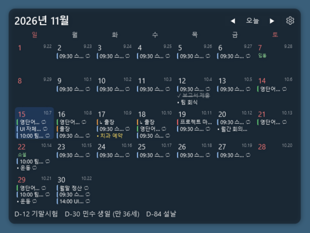

---

## 1. 설치와 제거

**설치**
1. zip 파일을 **모두 풀고**(압축 파일 안에서 바로 실행하면 안 됩니다) `Install.cmd` 를 더블클릭합니다.
2. 관리자 권한이 필요 없습니다. `%LocalAppData%\Programs\M-DeskCal` 에 설치되고 시작 메뉴에 바로 가기가 생깁니다.
3. Windows SmartScreen 이 "알 수 없는 게시자" 경고를 보이면 *추가 정보 → 실행* 을 누르세요. 베타에는 코드 서명이 없습니다.
4. .NET 을 따로 설치할 필요가 없습니다(런타임 포함).

**업데이트**: 새 zip 으로 `Install.cmd` 를 다시 실행하면 덮어씁니다. 데이터는 그대로입니다.

**제거**: *설정 → 앱 → 설치된 앱 → M-DeskCal → 제거* (또는 `Uninstall.cmd`). 일정·할 일 데이터를 함께 지울지 묻습니다(기본: 보존).

실행하면 바탕화면에 달력이 나타나고 화면 오른쪽 아래 **트레이(알림 영역)에 달력 아이콘**이 생깁니다. 달력이 안 보이면 아이콘을 더블클릭하거나 `Ctrl+Alt+D` 를 누르세요. 앱을 완전히 끄려면 트레이 → *종료* 입니다.

---

## 2. 설정은 어디서 하나요

설정은 세 곳에서 합니다. **변경은 누르는 즉시 적용·저장**됩니다(확인 버튼 없음).

| 어디서 | 무엇을 |
|---|---|
| **⚙ 톱니바퀴 빠른 메뉴** — 달력 오른쪽 위 | 매일 쓰는 기능 |
| **캘린더 설정 창** — 빠른 메뉴 맨 아래 *캘린더 설정…* 또는 트레이 | 모든 표시·동작 옵션 (8개 탭) |
| **트레이 메뉴** — 트레이 아이콘 우클릭 | 검색·빠른 입력·메모·가져오기/내보내기·동기화·AI 연동 등 기능 모음 |

### 2.1 ⚙ 빠른 메뉴

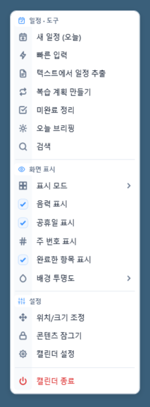

| 메뉴 | 하는 일 |
|---|---|
| 오늘로 이동 | 오늘이 보이도록 이동 |
| 새 일정 (오늘)… | 오늘 날짜로 일정 편집기를 엶 (`Ctrl+Alt+E`) |
| 빠른 입력… | 한 문장으로 일정 추가·질문 (`Ctrl+Alt+Q`, 3장) |
| 텍스트에서 일정 추출… · 복습 계획 만들기… · 미완료 정리… · 오늘 브리핑… | 3장의 해당 기능 |
| 검색… | 검색 창 (`Ctrl+Alt+F`) |
| 표시 모드 ▸ | 고정 월 · 변동 월(주 단위) · 전체 월(5줄 고정) · 고정 단일 행 · 변동 단일 행(오늘부터) |
| 음력 표시 · 공휴일 표시 · 주 번호 표시 · 완료한 항목 표시 | 체크(✓)로 켜고 끔 |
| 배경 투명도 ▸ | 완전 투명 · 20 · 40 · 60 · 80 · 100% |
| 위치/크기 조정 | 달력의 위치와 크기를 바꿈 (2.2) |
| 콘텐츠 잠그기 / 잠금 해제… | 내가 쓴 내용을 화면에서 숨김 (6장) |
| 캘린더 설정… | 캘린더 설정 창 |

### 2.2 위치/크기 조정

빠른 메뉴 또는 트레이의 *위치/크기 조정* 을 켜면 달력에 **점선 테두리**와 안내 문구가 나타납니다.

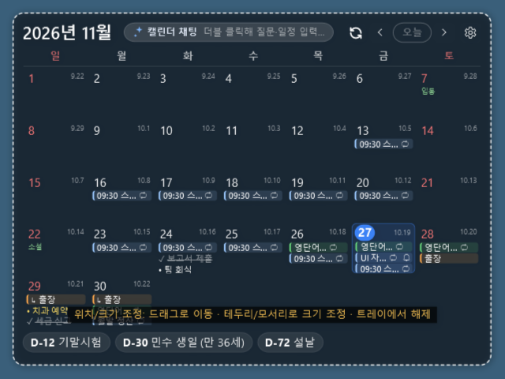

- **이동**: 달력 안쪽을 끕니다.
- **크기 조절**: 테두리의 **네 변**과 **네 모서리**를 끕니다(최소 320×240).
- **끝내기**: 같은 메뉴 항목을 다시 눌러 끕니다. 위치·크기는 자동 저장됩니다.
- D-day 카드와 바탕화면 시간표도 이때 끌어서 옮길 수 있습니다.

### 2.3 트레이 메뉴

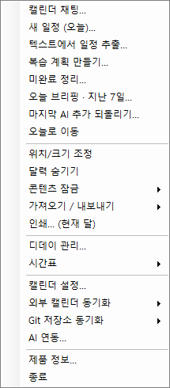

트레이 아이콘을 **더블클릭**하면 달력이 숨겨지거나 나타납니다.

| 묶음 | 항목 |
|---|---|
| 찾기·입력 | 검색… · 새 일정 (오늘)… · 빠른 입력… · 텍스트에서 일정 추출… · 복습 계획 만들기… · 미완료 정리… · 오늘 브리핑 · 지난 7일… · 마지막 추가 되돌리기…(되돌릴 묶음이 있으면 건수 표시) · 오늘로 이동 |
| 화면·데이터 | 위치/크기 조정 · 달력 숨기기/보이기 · 콘텐츠 잠금 ▸(지금 잠그기/잠금 해제, 비밀번호 설정·변경·해제) · 가져오기 / 내보내기 ▸ · 인쇄… (현재 달) |
| 메모·D-day·시간표 | 메모… · 디데이 관리… · 시간표 ▸(시간표 편집…, 바탕화면에 표시) |
| 설정·연동 | 캘린더 설정… · 외부 캘린더 동기화 ▸(동기화 설정…, 지금 동기화) · AI 연동…(승인 대기가 있으면 건수 표시) |
| 정보 | 제품 정보…(캘린더 설정의 *제품 정보* 탭) · 종료 |

### 2.4 캘린더 설정 창

왼쪽 탭을 눌러 이동합니다. 왼쪽 아래 **기본 설정으로 사용** 은 표시 설정을 처음 값으로 되돌립니다(일정·할 일·창 위치는 그대로).

| 탭 | 내용 |
|---|---|
| 캘린더 | 표시 방식(5가지 모드), 최대 행·지난 주 표시·한 줄 표시 일수, 주 번호·그림자, 음력·24절기·공휴일·기념일/명절 표시 |
| 셀 | 항목 기호(없음/번호/점), 셀 간격·줄 간격, 완료 항목 맨 아래로·완료 항목 표시·알림 표시(⏰)·완료 효과음·알림음 |
| 글꼴 및 색상 | 글꼴·크기·글자색, 캘린더 배경·**휴일 배경색**·휴일/쉬는 날/24절기 글자색, 배경 투명도, 배경 사진(폴더·맞춤·바꾸는 주기) |
| 메모 | 노트·디데이·시간표 열기, 바탕화면 시간표 표시 |
| 고급 | 시작 요일, 첫 번째 주 기준, 쉬는 날 지정, 단축키, Windows 시작 시 자동 실행, 휴일 데이터 편집·다시 읽기 |
| AI | AI 기능 켜기/끄기(기본 꺼짐), AI 서버 종류(Ollama / OpenAI 호환)·주소·모델, 연결 시험, 응답 대기 시간, 모델 유지 시간, 다른 컴퓨터의 주소 허용, **의미 검색**(임베딩 모델·색인), **아침 브리핑**(자동 표시·시각·평일만·AI 문장 다듬기), **정확도 기록** — 3장 참고 |
| 동기화 | **Git 저장소 동기화**: 저장소 주소·브랜치·폴더, 자동 동기화 주기, 지금 동기화, 마지막 결과 — 7.1절 참고 |
| 제품 정보 | 버전·시스템, 데이터 폴더 열기, 진단 정보 보기 |

<table>
<tr><td>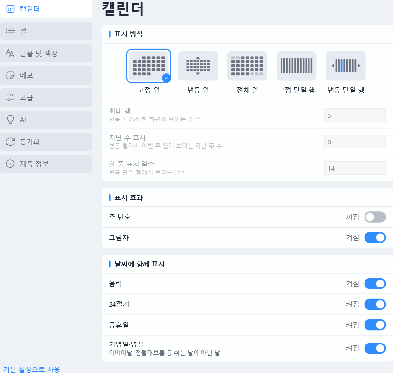</td>
<td>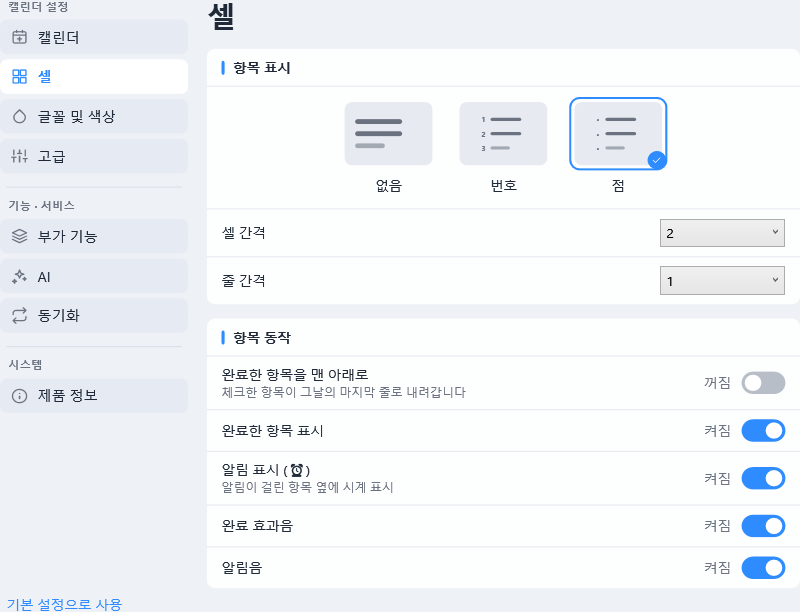</td></tr>
<tr><td align="center">캘린더 탭</td><td align="center">셀 탭</td></tr>
<tr><td>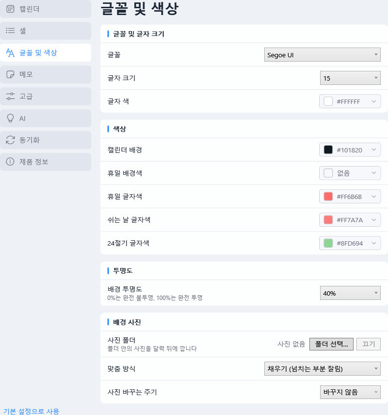</td>
<td>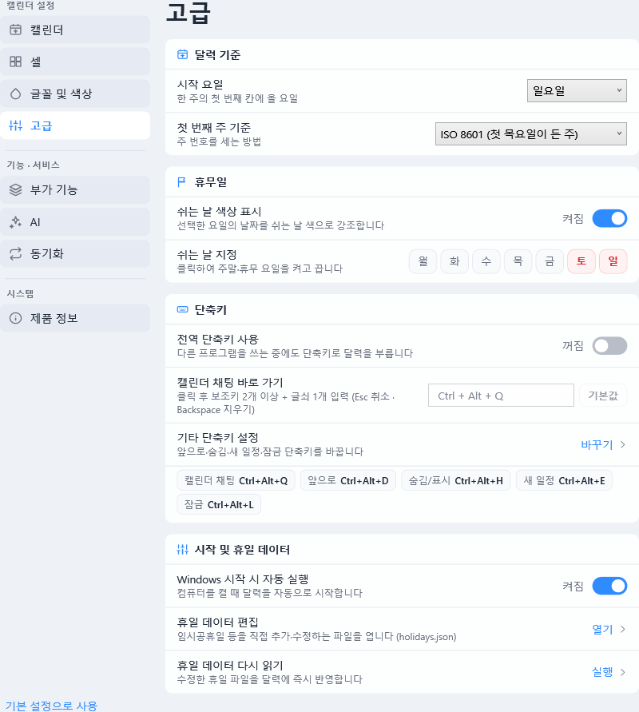</td></tr>
<tr><td align="center">글꼴 및 색상 탭</td><td align="center">고급 탭</td></tr>
<tr><td>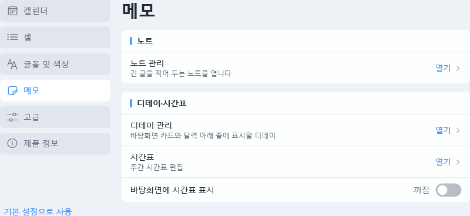</td>
<td>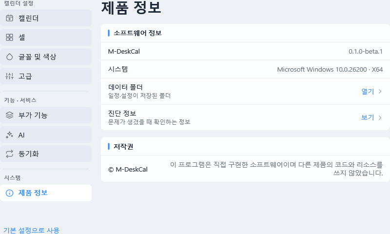</td></tr>
<tr><td align="center">메모 탭</td><td align="center">제품 정보 탭</td></tr>
</table>

**알아 두면 좋은 옵션**
- *변동 월* 에서만 **최대 행**·**지난 주 표시**, *변동 단일 행* 에서만 **한 줄 표시 일수** 가 켜집니다(나머지는 흐리게 잠김).
- **휴일 배경색**: 공휴일·쉬는 날 칸을 은은하게 칠합니다. 색 선택창의 *없음* 으로 끕니다. 오늘 칸의 강조색이나 직접 지정한 셀 색이 우선합니다.
- **배경 사진**: 폴더를 지정하면 그 폴더의 사진(png/jpg/bmp/gif/tif, 이름순, 최대 500장)이 달력 뒤에 깔립니다. 사진의 선명도는 배경 투명도를 따릅니다.
- **첫 번째 주 기준**: 주 번호를 세는 방법(ISO 8601 / 1월 1일이 든 주).

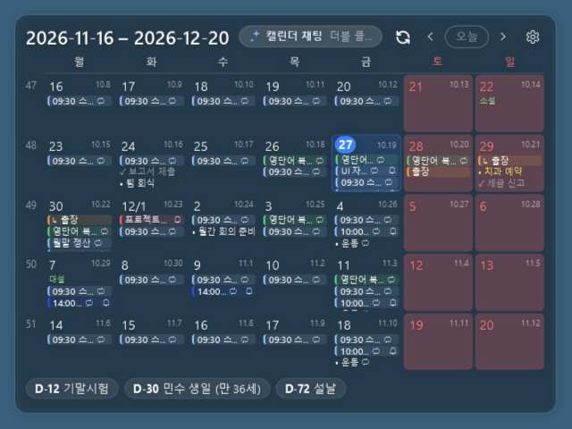

---

## 3. 기본 사용

| 하고 싶은 일 | 방법 |
|---|---|
| 할 일 적기 | 날짜 칸을 **더블클릭** → 한 줄에 하나씩 입력 → 오른쪽 위 ✓ · 바깥 클릭 · `Ctrl+Enter` 로 저장, `Esc` 로 취소 |
| 완료·색·반복·알림·D-day | 입력창 아래 **옵션 버튼**(아래 "할 일 옵션" 참고) |
| 완료 표시 | 항목 앞의 표시를 클릭 (또는 항목 우클릭 → 완료로 표시) |
| 항목 색·알림(간단히) | 항목 **우클릭** → 글자색 / 배경색 / 알림(당일·하루 전·3일 전 09:00) |
| 날짜 칸 전체 색 | 날짜 칸 우클릭 → 셀 배경색, 또는 입력창의 🎨 → 셀 색 |
| 이전 내용 되돌리기 | 항목 우클릭 → 이력 보기… → 복원 |
| 일정 추가 | 날짜 칸 우클릭 → 일정 추가… (또는 `Ctrl+Alt+E`) |
| 일정 고치기/지우기 | 일정 우클릭 → 일정 편집… / 일정 삭제… (반복 일정은 "이 일정만 / 이후 모두 / 전체" 선택) |
| 달 넘기기 | 마우스 휠, 또는 달력 위쪽의 ◀ ▶ 버튼. 오늘로 돌아가기는 가운데 "오늘" 버튼 |
| 위치·크기 바꾸기 | ⚙ 또는 트레이 → **위치/크기 조정** (2.2) |

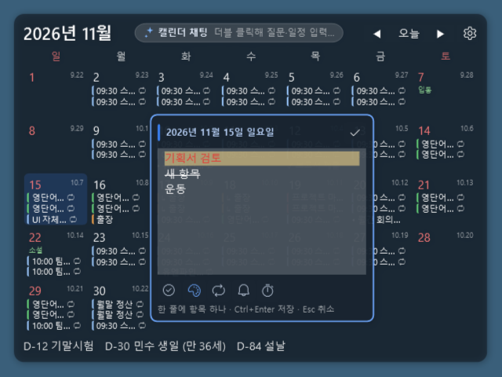

**할 일 옵션** (입력창 아래 아이콘 5개 — 커서가 있는 줄에 적용됩니다. 버튼을 누르면 그때까지 쓴 내용이 먼저 저장되며 입력창은 열려 있습니다)

| 버튼 | 하는 일 |
|---|---|
| ✓ 작업 완료 표시 | 그 줄을 완료로 표시(취소선)·해제. 입력창 안에서도 취소선으로 보입니다 |
| 🎨 텍스트 색상 / 셀 색상 | 글자색(그 줄)과 날짜 칸 배경색(그 날짜 칸 전체)을 팔레트에서 고름. 맨 앞 칸은 기본색으로 되돌리기, 무지개 칸은 다른 색 선택, **최근 사용** 색이 위에 남습니다 |
| 🔁 작업 반복 | 매일·평일·법정 근무일·매주·매월(날짜/요일)·말일·분기말·매년·음력 매년·에빙하우스, 간격, 종료(무한/횟수/종료일). 달력에는 ↻ 로 표시 |
| 🔔 알림 | 알림 시각(시:분)과 시점(당일·1일 전·2일 전·3일 전·1주 전, 여러 개 선택). 달력에는 ⏰ 로 표시 |
| ⏱ 기념일까지 카운트 다운 | 그 항목의 날짜를 D-day 로 만듦(일반·시험·생일·명절/기념일·만난 날), 바탕화면 카드/달력 아래 줄 표시 선택. 항목 오른쪽에 `D-12` 처럼 표시 |

<table>
<tr><td>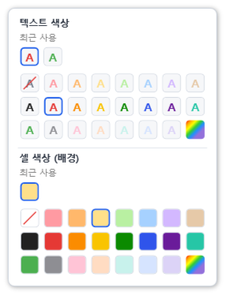</td>
<td>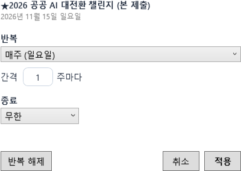</td>
<td>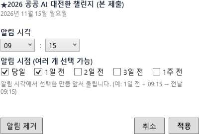</td>
<td>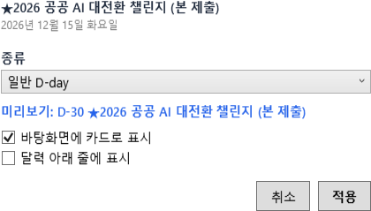</td></tr>
</table>

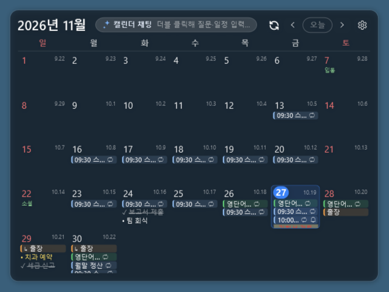

- 반복은 **날짜마다 독립된 항목**으로 만들어집니다(최대 1년 앞까지, 날이 바뀔 때 자동으로 이어서 만듦). 각 날짜의 항목은 따로 완료·삭제·수정할 수 있습니다.
- 반복을 설정하는 순간의 **글·색·알림이 이후 항목에 복사**됩니다. 그 뒤 한 날짜만 바꾸면 그 날짜에만 적용됩니다. 반복 규칙을 다시 적용하거나 *반복 해제* 를 누르면 **이후(미래) 항목은 지우고 다시 만듭니다**(이전 날짜 항목은 그대로).
- 카운트다운이 걸린 항목을 지우면 D-day 도 함께 지워지고, 항목의 글을 고치면 D-day 제목도 따라 바뀝니다.
- 입력창에서 `Esc` 를 눌러도 옵션 버튼을 누르면서 이미 저장된 내용은 남습니다.

**일정**: 제목, 시작·종료(종일 가능), **반복**(매일·매주·매월 같은 날짜/요일·매년·평일·말일·음력 매년 등), 반복 간격과 종료(횟수/날짜), **알림**(여러 개), 메모를 설정합니다. 알림은 화면 구석 카드와 효과음으로 뜨며, 절전에서 깨어난 뒤에도 놓친 알림(최대 24시간)을 알려 줍니다.

<table>
<tr><td>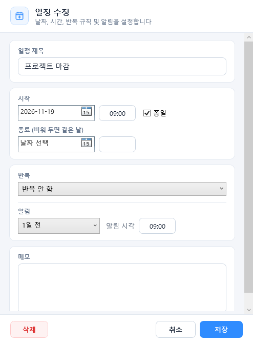</td>
<td>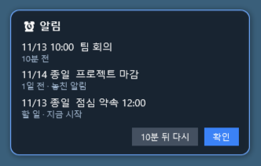</td></tr>
</table>

**휴일·음력·절기**: 한국 공휴일(2000~2050년)·대체공휴일·음력·24절기가 내장되어 있습니다(설정 → 캘린더 → *날짜에 함께 표시* 에서 켜기/끄기). 내장 데이터에 없는 휴일은 설정 → 고급 → *휴일 데이터 편집* 에서 `holidays.json` 으로 추가할 수 있습니다.

**빠른 입력 — 문장으로 일정 추가**: `Ctrl+Alt+Q`, ⚙ 빠른 메뉴 또는 트레이의 **빠른 입력…** 을 열고 한 문장을 적으면, 적는 동안 바로 일정 카드(제목·날짜(요일)·시각·반복·알림)가 나타나고 **Enter** 로 추가됩니다. `이번 주 일정 보여줘`·`내일 뭐 있어?`·`12월 할 일 알려줘` 처럼 **물어보면** 달력에서 읽은 목록을 보여 줍니다(줄 더블클릭 = 그 날짜로 이동, 아무것도 바꾸지 않음).

- 예: `다음 주 화요일 오후 2시 A사 미팅 1시간, 15분 전 알림` · `매주 월수금 아침 7시 운동` · `12월 3일 종일 치과 하루 전 알림` · `음력 8월 15일 매년 차례` · `매월 마지막 금요일 오후 5시 월간 보고`
- **AI 없이도 동작합니다.** 날짜·시각·반복·알림은 규칙으로 즉시 읽습니다. 날짜를 알 수 없으면 오늘로 대신하지 않고 "날짜를 알 수 없습니다"라고 알려 줍니다.
- 오전/오후를 쓰지 않았거나 연도를 정하지 않아 **추정한 것**은 카드 아래 메모로 알려 줍니다(예: "3시를 오후 3시로 봤습니다", "올해 지나서 내년으로 봤습니다"). 카드의 날짜를 확인하고 Enter 를 누르세요.
- 규칙으로 못 읽는 문장은 **설정 → AI** 를 켜면(Ollama 같은 AI 서버와 모델을 고르고 *연결 시험*) Enter 를 눌렀을 때 AI 가 해석해 봅니다. 이 결과에는 "AI 가 해석했습니다 — 날짜와 시각을 꼭 확인하세요"가 붙고, **작은 모델은 날짜를 틀릴 수 있습니다.**
- AI 는 기본적으로 **이 PC 의 AI 서버에만** 연결할 수 있어 달력 내용이 PC 밖으로 나가지 않습니다(다른 컴퓨터의 주소는 스위치를 켜야 하고 내용이 전송됩니다). 달력이 잠겨 있으면 쓸 수 없습니다. 어떤 경우에도 확인(Enter) 없이 일정이 추가되지 않습니다.
- 해석하지 못하면 이유를 알려 주고 **일정 편집기로 열기** 로 직접 입력할 수 있습니다.
- 이미 있는 일정과 **시간이 겹치거나 같은 일정**이면 카드에 ⚠ 로 알려 줍니다(일정 편집기에서 저장할 때도 확인 창이 뜹니다). 막지는 않고 선택은 내가 합니다.
- 카드의 **맞음/틀림** 은 횟수만 이 컴퓨터에 기록합니다(문장 내용은 저장하지 않음). *설정 → AI → 정확도 기록* 에서 규칙과 AI 가 내 문장을 얼마나 맞혔는지 볼 수 있고 지울 수 있습니다.
- 방금 추가한 것은 **마지막 추가 되돌리기**(빠른 입력 창·트레이 메뉴)로 한꺼번에 취소할 수 있습니다. 가장 최근 추가 한 번만 기억합니다.

**텍스트에서 일정 추출**: 공지·메일·메신저 대화를 붙여넣고 날짜가 있는 문장을 일정/할 일로 한꺼번에 추가합니다(트레이·⚙ 메뉴 **텍스트에서 일정 추출…**).

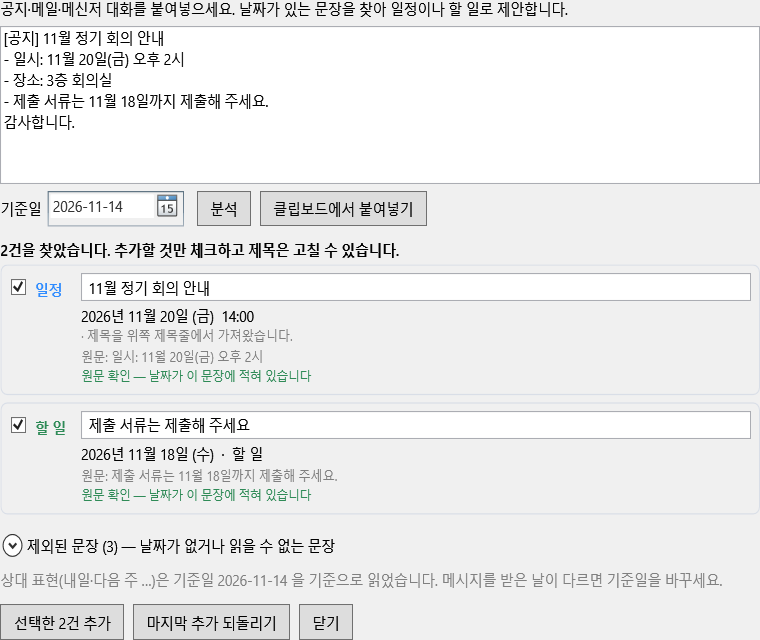

- 문장마다 **원문**과 읽은 날짜·시각을 함께 보여 주고, 체크 해제·제목 수정이 가능합니다. 시각이 있으면 *일정*, `~까지 제출` 같은 마감이면 *할 일* 로 제안합니다. 날짜가 없는 문장은 *제외된 문장* 에 이유와 함께 남습니다.
- **기준일**: `내일`·`다음 주` 같은 표현은 이 날짜를 기준으로 읽습니다(메시지를 받은 날이 오늘이 아니면 바꾸세요). `일시: 11월 20일(금)` 처럼 요일이 날짜와 다르면 메모로 알려 줍니다.
- 이미 달력에 있는 것(같은 제목·같은 시각)은 체크가 꺼져 있고, 겹치는 일정은 ⚠ 로 표시됩니다.
- 체크한 것을 **한 번에 추가**하며 2건 이상이면 추가 전에 데이터베이스를 `%AppData%\DeskCal\backup\before-ai-*.db` 로 백업합니다(최근 10개 유지). 잘못 추가했으면 **마지막 추가 되돌리기** 로 취소합니다.
- 붙여넣은 글은 **규칙으로만** 읽습니다(AI 를 거치지 않음). 글 속에 "이전 지시를 무시하고…" 같은 문장이 있어도 아무 일도 하지 못합니다.
- **사진·캡처 읽기(OCR)**: 같은 창에서 *이미지 파일…*, 이미지 **끌어다 놓기**, 클립보드의 캡처(`Win+Shift+S`)를 **Ctrl+V** 로 붙이기 중 아무거나 쓰면 Windows 에 들어 있는 OCR(한국어 인식기 필요)로 글자를 읽어 위 칸에 넣고 같은 방식으로 분석합니다. 오프라인으로 이 컴퓨터에서만 처리하고 이미지는 저장하지 않습니다. OCR 은 `14:30` 을 `1430` 으로 읽거나 숫자를 틀리게 읽을 수 있어(앱이 날짜가 있는 줄의 시각은 보정합니다) **날짜와 시각을 이미지와 꼭 대조**해야 하며, 창에 항상 이 경고가 표시됩니다. 읽은 글자는 위 칸에서 고칠 수 있습니다.

**빈 시간 묻기**: 빠른 입력에 `이번 주 빈 시간 알려줘`·`내일 한가한 시간`처럼 물으면 09:00~18:00 사이에서 **한 시간 이상 비는 때**를 알려 줍니다. 시각이 있는 일정과 시간표 수업은 "바쁨"으로 보고, 종일 일정과 날짜 칸 할 일은 막지 않습니다. 여러 날을 물으면 주말·공휴일은 뺍니다.

**아침 브리핑·지난 7일 돌아보기**: 트레이·⚙ 메뉴의 **오늘 브리핑…** 은 하루를 몇 줄로 보여 줍니다 — 일정, 할 일, 전날 끝내지 못한 것, 가장 긴 빈 시간, 가까운 디데이(14일 이내), 시간이 겹치는 일정. 모두 달력에서 읽은 값이고 ◀ ▶ 로 다른 날도 볼 수 있습니다. **지난 7일 돌아보기** 탭은 끝낸 할 일·새로 적은 할 일·**다른 날로 미룬 할 일**(더 뒤 날짜로 옮긴 것)·끝내지 못한 것·일정이 몰린 요일을 보여 줍니다. 끝낸 것·미룬 것의 기록은 이 기능이 켜진 날부터 쌓이므로 처음에는 비어 있고, 기록이 주의 일부만 덮으면 그렇다고 알려 줍니다.

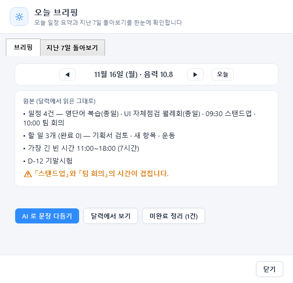

- **자동으로 띄우기**: *설정 → AI → 아침 브리핑* 에서 켜면(기본 꺼짐) 하루에 한 번, 정한 시각부터 18시 사이에 작은 창으로 나타납니다(키보드 포커스를 가져가지 않음, 기본은 평일·공휴일 제외). AI 없이 동작합니다.
- **AI 로 문장 다듬기**(선택): 버튼을 누르거나 자동 표시 때 켜 두면 AI 가 위 줄들을 부드러운 문장으로 바꿉니다. AI 의 문장은 **모든 일정·할 일·끝내지 못한 일·디데이가 그대로 들어 있고 달력에 없는 시각이 없을 때만** 보여 주며, 아니면 버리고 원본 줄을 보여 줍니다(원본은 항상 아래에 있습니다). 실패하면 30분·1시간·2시간… 최대 8시간으로 간격을 늘려 다시 시도합니다. **작은 모델은 항목을 빠뜨리는 일이 잦아 대부분 버려질 수 있습니다.**

**의미 검색**: 검색 창의 **의미 검색** 을 켜면 글자가 달라도 뜻이 비슷한 할 일·일정을 찾습니다(예: `병원 갔던 날` → `치과 정기검진`, `빌린 책 돌려주기` → `도서관 책 반납`). `지난달`·`작년 가을`·`최근 3개월`·`11월` 같은 기간은 날짜 범위로 바꿔 적용합니다.
- 사용하려면 *설정 → AI* 에서 AI 를 켜고, *의미 검색 사용* 을 켜고, **임베딩 모델**(예: `bge-m3`, 한국어 지원)을 고른 뒤 *색인 만들기* 를 누릅니다(색인은 새로 쓰거나 고친 글만 다시 계산하며 10분마다 자동으로도 갱신됩니다).
- 색인은 글에서 만든 **숫자 목록(파생 데이터)** 으로 이 컴퓨터의 데이터베이스에 저장되며, 데이터베이스와 마찬가지로 암호화되지 않습니다. 설정에서 *색인 지우기* 로 언제든 지울 수 있고 달력이 잠겨 있으면 만들지도 쓰지도 않습니다.
- 글자가 그대로 들어간 항목은 의미 검색에서도 맨 위에 나오고, 임베딩 서버가 꺼져 있으면 알려 주고 글자 검색만 합니다. **할 일과 일정만** 대상이며 메모는 아직 포함되지 않습니다.

**복습 계획 만들기**: 트레이·⚙ 메뉴의 **복습 계획 만들기…** 에서 복습할 내용과 날짜를 정하면 망각곡선에 맞춰 다시 볼 날들을 **할 일**로 만듭니다. AI 를 쓰지 않고 날짜를 계산으로만 정합니다.

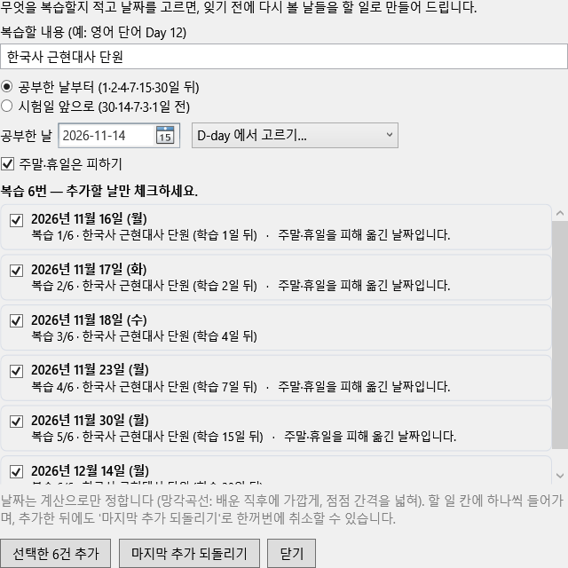

- **공부한 날부터**: 1·2·4·7·15·30일 뒤 6번. **시험일 앞으로**: 30·14·7·3·1일 전(시험일에는 만들지 않음). 등록해 둔 D-day 에서 시험일을 골라 올 수 있습니다.
- **주말·휴일은 피하기**(기본 켜짐): 공부한 날부터는 다음 평일로, 시험일 앞으로는 앞의 평일로 옮기고 "옮긴 날짜입니다"로 표시합니다. 두 번이 같은 날에 겹치지 않으며(시험 앞으로는 뒤의 하나를 줄임), 이미 지난 날은 체크가 꺼집니다.
- 날짜마다 체크를 풀 수 있고, 체크한 것만 "복습 2/6 · 주제 (학습 2일 뒤)" 형태의 할 일로 한꺼번에 들어갑니다. 2건 이상이면 추가 전에 데이터베이스를 백업하고 **마지막 추가 되돌리기** 로 취소할 수 있습니다.

**미완료 정리**: 트레이·⚙ 메뉴 또는 브리핑의 **미완료 정리…** 는 지난 날에 끝내지 못한 할 일을 오늘이나 다음 평일로 옮깁니다. 규칙만 쓰고 AI 를 쓰지 않으며, 옮기기 전에 모든 날짜를 보고 바꿀 수 있습니다.

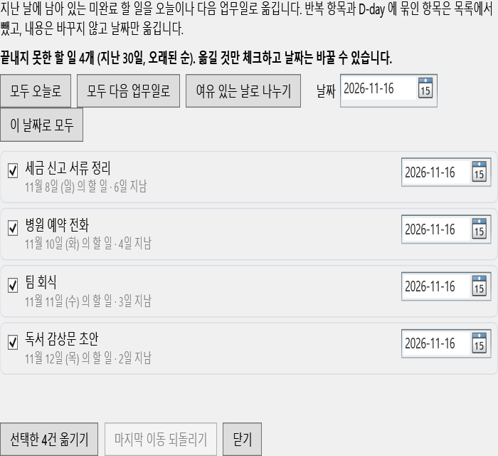

- 대상: 최근 **30일** 안에 끝내지 못한 할 일(오래된 순, 며칠 지났는지와 이미 옮긴 횟수 표시). **반복 항목과 D-day 에 묶인 항목은 제외**됩니다(반복은 알아서 생기고, D-day 항목을 옮기면 D-day 날짜가 바뀌기 때문).
- **모두 오늘로**(오늘이 주말·휴일이면 다음 평일) · **모두 다음 업무일로** · **이 날짜로 모두** · **여유 있는 날로 나누기**(다음 5개 평일 중 남은 할 일이 적고 시각이 있는 일정이 덜 잡힌 날부터 채움 — 일정 2시간을 할 일 1개로 셈). 항목별 날짜 선택기로 개별 조정도 됩니다.
- **내용은 바꾸지 않고 날짜만** 옮깁니다. 3번 이상 옮긴 항목에는 "쪼개거나 지우는 편이 나을 수 있다"는 안내가 붙습니다.
- **마지막 이동 되돌리기**: 가장 최근에 옮긴 묶음을 원래 날짜로 돌립니다. 그 뒤에 직접 옮기거나 고친 항목은 건드리지 않습니다.

---

## 4. 전역 단축키

| 단축키 | 동작 |
|---|---|
| `Ctrl+Alt+D` | 달력을 앞으로 가져오기 |
| `Ctrl+Alt+H` | 달력 숨기기 / 보이기 |
| `Ctrl+Alt+E` | 오늘 날짜로 새 일정 |
| `Ctrl+Alt+F` | 검색 |
| `Ctrl+Alt+L` | 콘텐츠 잠금 / 해제 |
| `Ctrl+Alt+Q` | 빠른 입력 (문장으로 일정 추가·질문) |

다른 프로그램이 같은 단축키를 쓰고 있으면 등록되지 않고 알려 줍니다. **캘린더 설정 → 고급 → 단축키** 에서 *전역 단축키 사용* 을 켜고 끄거나 *단축키 설정 → 바꾸기* 로 조합을 바꿀 수 있습니다.

---

## 5. 기능 모음 (트레이 메뉴)

- **검색…** — 일정·할 일을 글자·기간·색·완료 여부로 찾고, 결과를 더블클릭해 그 날로 이동.
- **가져오기 / 내보내기** — JSON(전체 백업) · CSV · ICS(다른 달력 프로그램) · Excel(.xlsx, 보기 전용). 가져오기 전에 자동으로 데이터베이스를 백업(`%AppData%\DeskCal\backup`)하며, 같은 파일을 다시 가져와도 중복되지 않습니다.
- **디데이 관리…** — D-Day, 기념일(N일째/N주년), 생일(만 나이), 명절, 음력 지원. 바탕화면 카드/달력 아래 표시.
- **메모…** — 제목·본문·색이 있는 메모, 이력 복원, 삭제 되살리기.
- **시간표 ▸** — 교시·시각을 정하고 과목/장소를 입력. *바탕화면에 표시* 로 달력처럼 바탕화면에 붙일 수 있습니다.
- **인쇄… (현재 달)** — 가로 A4 한 장.
- **콘텐츠 잠금 ▸** — 내가 쓴 내용을 화면에서 숨깁니다(6장).
- **외부 캘린더 동기화 ▸ · AI 연동…** — 7·8장.
- 모양 설정(표시 모드·주 시작 요일·음력/절기/공휴일·투명도·그림자·기호·배경 사진)과 **Windows 시작 시 자동 실행**·**데이터 폴더 열기**·**단축키** 는 *캘린더 설정* 창에 있습니다.

<table>
<tr><td>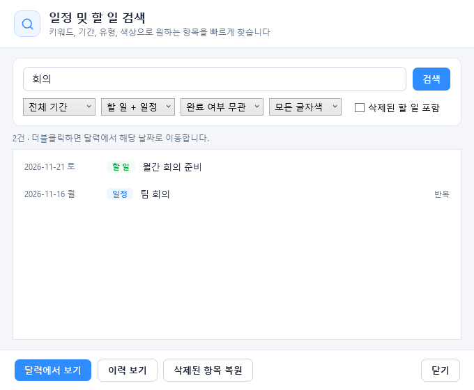</td>
<td>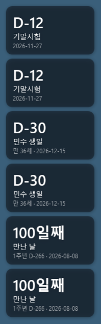</td></tr>
<tr><td>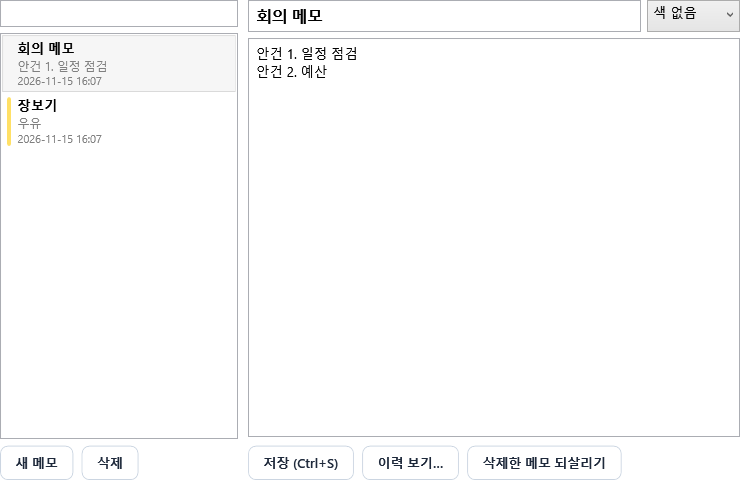</td>
<td>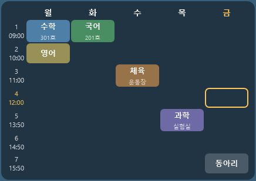</td></tr>
<tr><td>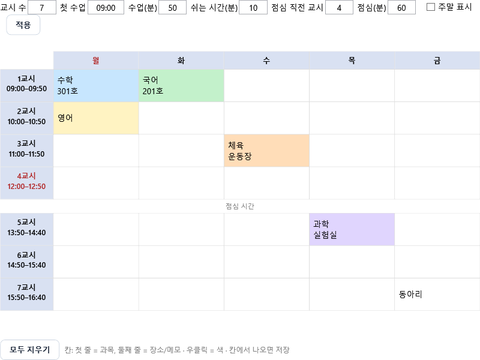</td>
<td>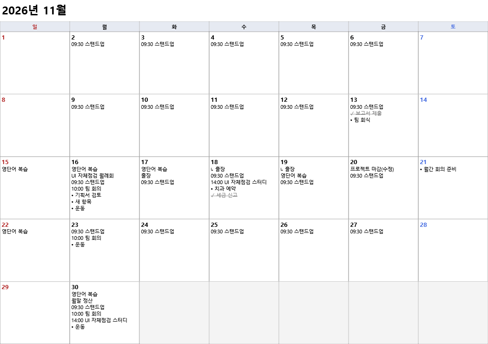</td></tr>
</table>

---

## 6. 콘텐츠 잠금 (화면 가리기)

`Ctrl+Alt+L` 로 잠그면 달력에서 **내가 쓴 내용(할 일·일정·디데이)이 사라지고** 날짜·공휴일만 남습니다. 디데이 카드·시간표 위젯도 숨겨지고, 알림은 "🔒 잠긴 알림" 으로만 보입니다. 푸는 방법은 `Ctrl+Alt+L` 또는 트레이에서 *잠금 해제…* 입니다.

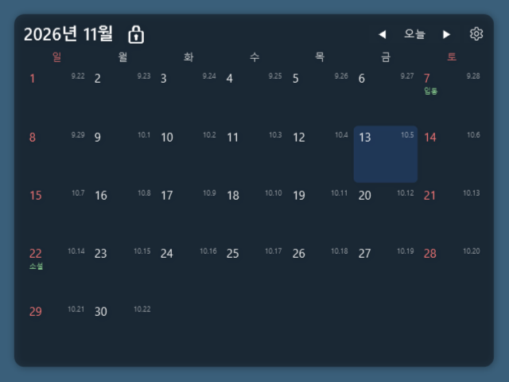

- 트레이 → 콘텐츠 잠금 → *비밀번호 설정…* 으로 비밀번호(4자 이상)를 정하면 해제할 때 입력해야 합니다. 비밀번호는 해시로만 저장되고, **잊어버리면 복구할 방법이 없습니다.**
- ⚠ **이 기능은 화면을 가리는 것이지 파일을 암호화하는 것이 아닙니다.** 누군가 `%AppData%\DeskCal\deskcal.db` 파일을 직접 열면 내용을 읽을 수 있습니다. 민감한 PC 에서는 Windows 계정 잠금과 디스크 암호화(BitLocker)를 함께 쓰세요.

---

## 7. 외부 캘린더 동기화 (CalDAV)

트레이 → **외부 캘린더 동기화 ▸ 동기화 설정…** 에서 Nextcloud·Synology·Radicale·iCloud 등 **CalDAV** 캘린더의 **주소 하나**와 사용자 이름·비밀번호를 입력합니다. (iCloud 처럼 2단계 인증을 쓰는 서비스는 *앱 전용 비밀번호* 를 만들어 쓰세요.) *Google·Microsoft(Outlook.com) 는 베타에서 지원하지 않습니다.*

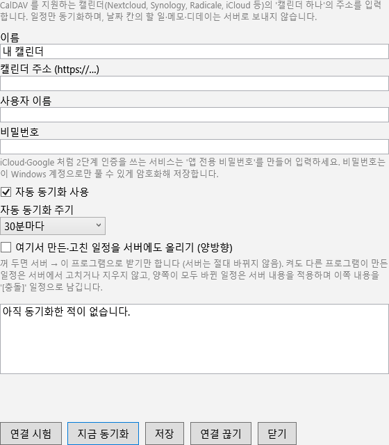

- **일정만** 동기화합니다. 날짜 칸의 할 일·메모·디데이는 서버로 보내지 않습니다.
- **기본은 "받기 전용"** — 서버의 일정을 가져오기만 하고 서버는 절대 바꾸지 않습니다. *양방향* 을 켜면 여기서 만든·고친 일정을 서버에도 올립니다(처음 켜면 지금까지의 일정이 전부 올라갑니다).
- **다른 프로그램이 만든 일정은 서버에서 고치거나 지우지 않습니다.** 여기서 고친 내용은 이 PC 에만 남습니다.
- 양쪽에서 같은 일정을 바꾼 **충돌**이 나면 서버 내용을 적용하고, 이 PC 의 내용은 `[충돌] 제목` 일정으로 남깁니다.
- 주소는 `https://` 여야 하고, 비밀번호는 이 Windows 계정으로만 풀 수 있게 암호화되어 저장됩니다.
- 자동 동기화 주기(기본 30분)와 *지금 동기화* 를 쓸 수 있습니다. 연결을 끊어도 받아 온 일정은 남습니다.

### 7.1 Git 저장소 동기화 (여러 PC 에서 같은 달력 쓰기)

캘린더 설정 → **동기화** 탭(또는 트레이 → **Git 저장소 동기화 ▸ 동기화 설정…**)에서 Git 저장소 주소를 넣으면, 달력의 **모든 내용**을 그 저장소의 한 폴더(기본 `my_calendar_sync`)에 두고 여러 PC 가 함께 씁니다.

- **올라가는 것**: 할 일(알림 포함), 일정(반복·건너뛴 날·알림 포함), 디데이, 메모, 할 일 반복 규칙, 시간표, 휴일 수정 파일(`holidays.json`). 항목 하나가 JSON 파일 하나입니다(`items/`, `events/`, `countdowns/`, `notes/`, `series/`, `timetable.json`, `holidays.json`).
- **PC 마다 따로인 것**: 창 위치·크기, 표시 설정, AI 설정, 잠금 비밀번호, CalDAV 계정, 이력·검색 색인.
- **준비**: 그 PC 에 Git for Windows 가 설치되어 있고 저장소에 로그인(자격 증명 관리자 또는 SSH 키)되어 있어야 합니다. 처음이면 명령 창에서 `git clone <주소>` 를 한 번 해 로그인해 두세요. 프로그램은 비밀번호를 저장하지 않습니다.
- **새 PC 추가**: M-DeskCal 을 설치하고 같은 주소·폴더를 입력한 뒤 *지금 동기화* 를 누르면 저장소의 달력을 받아 와 그 PC 의 내용과 합칩니다(지우지 않고 합칩니다).
- **합치는 방법**: 지난 동기화 이후 한쪽만 바뀐 항목은 그쪽 내용을 따르고, 한쪽에서 지운 항목은 다른 쪽에서도 지웁니다. 같은 항목을 양쪽에서 고쳤으면 **나중에 고친 쪽**이 남고, 덮어쓴 글은 이력에 남습니다. 한쪽에서 지우고 다른 쪽에서 고쳤으면 고친 내용이 살아남습니다.
- **안전 장치**: 이 PC 의 내용을 바꾸기 전에 `%AppData%\DeskCal\backup\before-gitsync-*.db` 로 복사본을 남깁니다(최근 10개). 저장소의 다른 폴더·파일은 받지도 고치지도 않습니다(그 폴더만 체크아웃). 다른 PC·앱이 먼저 올렸으면 그 위에 다시 합쳐 올립니다. 형식이 깨진 파일은 건너뛰고 결과에 알려 줍니다.
- **자동 동기화**: 켤 때 한 번, 그 뒤로 정한 간격(기본 15분)마다. 콘텐츠 잠금 중에는 하지 않습니다.
- ⚠ 일정 내용이 그대로 올라가므로 저장소는 **비공개**로 두세요.

---

## 8. AI 연동 (MCP)

Claude Desktop 같은 AI 프로그램이 달력을 **읽고**, 변경을 **요청**하게 할 수 있습니다. 기본은 꺼져 있습니다.

1. 트레이 → **AI 연동…** → *새 토큰 만들기*. 표시되는 설정(JSON)을 AI 프로그램의 MCP 설정에 붙여넣습니다. 토큰은 **만든 직후에만** 볼 수 있습니다.
2. AI 는 일정·할 일·디데이·메모·시간표를 조회·검색할 수 있습니다. 음력·공휴일·24절기, **빈 시간 찾기**, 하루 요약처럼 틀리기 쉬운 계산은 AI 가 직접 하지 않고 이 앱에 맡깁니다. AI 프로그램에 따라 "아침 브리핑", "앞으로 7일", "지난 주 돌아보기" 같은 **준비된 질문(프롬프트)** 도 고를 수 있습니다.
3. AI 가 일정·할 일·디데이·메모를 추가·수정·삭제하려 하면 **바로 반영되지 않고** 이 창의 **승인 대기** 에 쌓입니다. 내용을 읽고 *승인* 하거나 *거부* 하세요. 하루가 지나면 자동으로 만료됩니다.
4. 모든 AI 호출은 *기록* 탭에 남습니다. 달력이 **잠겨 있으면** AI 는 아무것도 볼 수 없습니다.

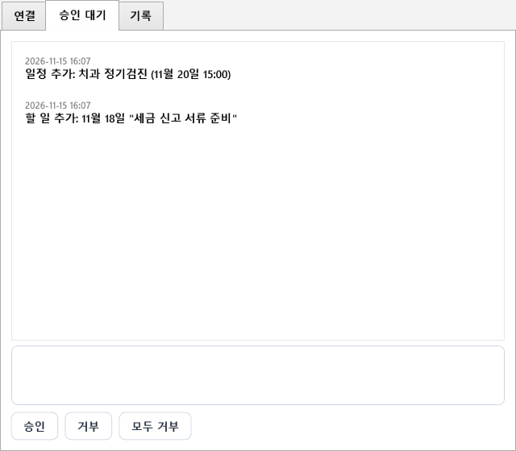

⚠ AI 는 달력에 적힌 글을 읽습니다. 일정 제목·메모에 AI 에게 말을 거는 문장이 섞여 있을 수 있으니, **승인하기 전에 항상 내용을 확인**하세요. 연동이 필요 없으면 끄거나 토큰을 폐기하세요.

⚠ **AI 가 읽은 내용은 그 AI 프로그램으로 전달됩니다.** Claude Desktop 처럼 클라우드 AI 를 연결하면 일정·메모·디데이 내용이 이 PC 밖으로 나갑니다. 민감한 내용이 있다면 콘텐츠 잠금을 쓰거나 연동을 끄세요.

AI 가 쓸 수 있는 도구 (참고)

| 종류 | 도구 |
|---|---|
| 읽기 | `list_events` · `list_items` · `search` · `list_countdowns` · `list_notes` · `get_note` · `get_timetable` · `get_day_summary` · `get_activity_summary`(끝낸 것·미룬 것 기록, 기록은 처음 쓰기 시작한 날부터) · `list_overdue_items`(끝내지 못한 채 지난 할 일, 며칠 지났는지·옮긴 횟수·옮길 날 제안) |
| 계산 | `find_free_time`(빈 시간) · `korean_calendar_info`(요일·음력·절기·공휴일) · `lunar_to_solar`(음력→양력) |
| 변경 요청(승인 필요) | `create_event` · `update_event` · `delete_event` · `add_item` · `set_item_done` · `move_item`(할 일을 다른 날로 옮김) · `create_countdown` · `add_note` |
| 확인 | `get_request_status` |

일정의 반복 규칙은 `FREQ=WEEKLY;BYDAY=MO,WE` 같은 표준 형식 외에 이 앱 고유 키워드(`weekday` 평일, `monthlast` 월말, `season` 분기말, `legalworkday` 법정 근무일, `lunaryear` 음력 매년, `ebbinghaus` 복습 간격)도 쓸 수 있습니다. 빈 시간 계산은 시각이 있는 일정과 시간표 수업을 "바쁨"으로 보고(끝 시각이 없는 일정은 60분), 종일 일정과 날짜 칸 할 일은 막지 않습니다.

---

## 9. 문제 해결

| 증상 | 확인할 것 |
|---|---|
| 달력이 안 보인다 | 트레이 아이콘을 더블클릭 / `Ctrl+Alt+D`. 숨김 상태였을 수 있습니다. 트레이 아이콘이 안 보이면 작업 표시줄 `^` 안을 확인하세요. |
| 달력이 아이콘을 가린다 | ⚙ → *위치/크기 조정* 으로 아이콘이 없는 자리로 옮기세요. |
| 단축키가 안 먹는다 | 다른 프로그램이 이미 쓰는 조합일 수 있습니다(시작할 때 알려 줍니다). 설정 → 고급 → 단축키 설정에서 변경. |
| 동기화가 실패한다 | 주소가 *캘린더 하나* 의 주소인지, 아이디·비밀번호(앱 전용 비밀번호), 인터넷 연결을 확인. 동기화 창의 *연결 시험* 으로 원인 메시지를 볼 수 있습니다. |
| 데이터를 옮기고 싶다 | 내보내기(JSON) → 새 PC 에서 가져오기. 또는 `%AppData%\DeskCal` 폴더를 복사. |
| 문제를 신고할 때 | 설정 → 제품 정보 → *진단 정보 보기* 의 내용과 `%AppData%\DeskCal` 의 로그(`m0.log`)를 알려 주세요. |

**데이터 위치**: `%AppData%\DeskCal\deskcal.db`(데이터), `backup\`(가져오기 전 `before-import-*.db`, 여러 건 일괄 추가 전 `before-ai-*.db` 자동 백업), `holidays.json`(사용자 휴일), `m0.log`(진단 로그). 앱을 완전히 끄려면 트레이 → *종료*.

---

## 10. 알려진 한계 (베타)

- 플로팅 버튼 없음(트레이와 단축키로 대체). 바탕화면 캡처 배경 없음. 코드 서명·자동 업데이트 없음(새 zip 으로 직접 업데이트).
- 반복 규칙 "31일" 은 짧은 달에 **말일로 당겨져** 표시됩니다(다른 달력 프로그램은 그 달을 건너뜁니다).
- 인쇄는 현재 달만, 시간표는 JSON 백업에 포함되지 않습니다.
- 동기화는 CalDAV 일정만(할 일·메모·디데이 제외, 반복 일정의 개별 수정본 제외).
- 복습 계획의 *주말·휴일 피하기* 와 미완료 정리의 *다음 업무일* 은 **토·일과 공휴일**을 쉬는 날로 봅니다(설정 → 고급의 쉬는 요일을 바꿔도 반영되지 않음).
- 의미 검색은 할 일·일정만 대상이며 메모는 포함되지 않습니다.
- 여러 모니터·고배율 화면에서의 배치는 충분히 시험되지 않았습니다.
